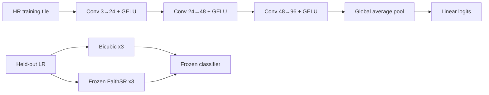

# Auxiliary Land-Cover Classifier Model Card

## Why this experiment exists

This model is a frozen downstream probe, not the proposed super-resolution model. It tests whether detail produced by FaithSR preserves information useful for land-cover classification relative to bicubic interpolation. It follows the reconstruction/false-edge ablations and adds task-level evidence.

Labels are the majority non-zero ESA WorldCover class inside the 126x126 map window centred at the latitude/longitude encoded in each 128x128 RGB filename. Training/calibration/final-test geographic groups are disjoint. Classes: 10=tree_cover, 20=shrubland, 30=grassland, 40=cropland, 50=built_up, 60=bare_sparse, 80=water.

## Mathematical function

For blocks i=1..3, `h_i = GELU(Conv3x3,stride2(h_(i-1)))`. Global average pooling gives `v_c = mean_(p,q) h_3[c,p,q]`, and logits are `z = Wv+b`; the predicted class is `argmax(z)`. Cross-entropy trains the probe. GELU is used for smooth gradients and global average pooling avoids a location-specific dense head.

## Layers

| Stage | Shape | Why |
|---|---|---|
| Conv + GELU 1 | 3 to 24, 3x3, stride 2 | Low-level colour/edge evidence with controlled downsampling. |
| Conv + GELU 2 | 24 to 48, 3x3, stride 2 | Mid-level texture evidence. |
| Conv + GELU 3 | 48 to 96, 3x3, stride 2 | Broader semantic context. |
| Global average pool | 96 channels to 96-vector | Spatially robust patch descriptor. |
| Linear | 96 to 7 logits | Auditable class decision. |

Trainable parameters: 53,335.

Split: `{"calibration_groups": 9, "fit_groups": 49, "test_groups": 14}`.
