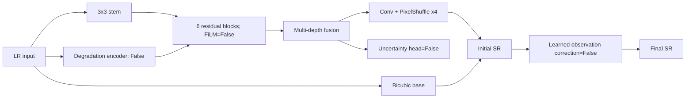

# Experiment Model Card: faithsr-lite-x4-distilled

## Purpose and lineage

- Why this experiment was run: Isolate full-schedule output and edge distillation from the accepted personalized native-x4 teacher.
- Previous experiment/connection: swin2sr-native-x4-diagnostic-v2
- Scale: exact native 4x
- Trainable parameters: 62,502
- Degradation adaptation: False
- Learned observation consistency: False
- Spatial uncertainty: False
- Compression-gated refinement: False

## Mathematical forward function

\[
f_0=C_{3\times3}(x),\qquad
h_i=P_{2,i}(\operatorname{GELU}(D_i(\operatorname{GELU}(P_{1,i}(f_{i-1}))))),
\]

\[
f_i=f_{i-1}+s_i h_i\odot\sigma(G_i(h_i)),\qquad
\hat y_0=\operatorname{Bicubic}_4(x)+\operatorname{PixelShuffle}_4(C_r(f)).
\]

This control variant intentionally omits degradation conditioning, learned observation correction, and uncertainty.

The training objective and degradation equations are frozen in `docs/research/model-and-experiment-methodology.md` and instantiated by the exact configuration below.

## Architecture figure



## Top-level layers and parameters

| Name | Layer/module | Parameters |
|---|---|---:|
| `shallow` | Conv2d | 896 |
| `blocks` | ModuleList | 32,310 |
| `fusion` | Sequential | 15,424 |
| `reconstruction` | Sequential | 13,872 |

## Activations and rationale

| Activation | Module count | Why used |
|---|---:|---|
| GELU | 19 | Smooth feature transformation; preserves small negative evidence. |
| Sigmoid | 6 | Bounds gates, severities, or uncertainty to [0,1]. |

PixelShuffle is a deterministic tensor rearrangement, not an activation. For RGB x4, the preceding convolution predicts 3x4²=48 sub-pixel channels.

## Exact configuration

```yaml
seed: 0
scale: 4
model:
  channels: 32
  num_blocks: 6
  embed_dim: 48
  kernel_size: 7
  max_consistency_strength: 0.2
data:
  crop_size: 192
  train_ratio: 0.5
  split_grid_degrees: 0.1
  extensions:
  - .tif
  - .tiff
  mixed_probability: 0.75
  compression_focus_probability: 0.5
  compression_focus_floor: 0.8
degradation:
  curriculum_epochs: 15
  start_severity: 0.2
  mtf_probability: 0.5
training:
  epochs: 60
  batch_size: 8
  validation_batch_size: 16
  teacher_batch_size: 2
  workers: 2
  learning_rate: 0.0002
  weight_decay: 0.0001
  amp: true
loss:
  charbonnier: 1.0
  ssim: 0.1
  gradient: 0.03
  frequency: 0.02
  observation: 0.05
  degradation: 0.02
  distillation: 0.05
  distillation_edge: 0.01
  compression_focus: 1.0
inference:
  tile_size: 512
  overlap: 32
variant: distilled
resolved_model:
  in_channels: 3
  out_channels: 3
  channels: 32
  num_blocks: 6
  embed_dim: 48
  kernel_size: 7
  scale: 4
  use_degradation_adaptation: false
  use_observation_consistency: false
  use_compression_refinement: false
  max_consistency_strength: 0.2
```

## References

- Swin2SR: https://arxiv.org/abs/2209.11345
- GELU: https://arxiv.org/abs/1606.08415
- FiLM: https://arxiv.org/abs/1709.07871
- PixelShuffle/sub-pixel convolution: https://arxiv.org/abs/1609.05158
- Canonical project methodology: `docs/research/model-and-experiment-methodology.md`


<!-- GENERATED_RESULTS_START -->
## Measured training result

Checkpoint selection rule: maximum validation PSNR. These values come directly from `metrics.csv`.
Training duration: 265.45 seconds.

| Checkpoint row | Epoch | train_loss | psnr | ssim | false_edge_rate |
|---|---:|---:|---:|---:|---:|
| Best | 54 | 0.1026302695274353 | 21.895003000895183 | 0.5281879107157389 | 0.13201111555099487 |
| Final | 60 | 0.1049007847905159 | 21.894416173299152 | 0.5277038415273031 | 0.13216743369897208 |
<!-- GENERATED_RESULTS_END -->
