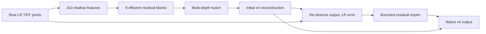

# Experiment Model Card: faithsr-hybrid-x4-residual_cascade

## Purpose and lineage

- Why this experiment was run: Test whether a bounded second-stage expert can improve sharpness while correcting LR re-observation error.
- Previous experiment/connection: faithsr-lite-x4-personalized-ablation-v1
- Variant: `residual_cascade`
- Scale: native 4x (satisfies the minimum 3x requirement)
- Input/output: matching image bands; experiments use 8-bit, three-band TIFF imagery
- Trainable parameters: 147,732

## Application-input rule

The deployed app passes the user's normalized TIFF pixels directly to the model. Synthetic degradation is a supervised training-data construction method only; it is not an inference prerequisite. Original TIFF metadata is handled by the inference pipeline, not encoded into neural pixels.

## Common mathematical model

Let the input be a batch of normalized LR images with shape `batch x bands x height x width`:

$$
X \in [0,1]^{B \times C \times H \times W}.
$$

The common local backbone is:

$$
F_0 = C_{3\times3}(X),
$$

$$
F_i = F_{i-1} + s_i\,C_{1\times1}\!\left(DW_{3\times3}\!\left(\operatorname{GELU}\!\left(C_{1\times1}\!\left(\operatorname{GELU}\!\left(DW_{3\times3}(F_{i-1})\right)\right)\right)\right)\right),
$$

where `DW` is a depthwise convolution and each learned residual scale starts at 0.1. Multi-depth features are concatenated and fused:

$$
F = F_0 + C_{3\times3}\!\left(\operatorname{GELU}\!\left(C_{1\times1}([F_1,\ldots,F_N])\right)\right).
$$

The first native-x4 estimate is:

$$
\widehat{Y}_0 = \operatorname{Bicubic}_4(X) + \operatorname{PixelShuffle}_4(C_r(F)).
$$

## Variant-specific function

The cascade does not degrade the application input. It only re-observes its own first SR estimate:

$$
\widetilde{X}_0 = \operatorname{AreaDownsample}_{4}(\widehat{Y}_0),
\qquad E = X - \widetilde{X}_0.
$$

The second-stage expert predicts a residual from the real LR input and this consistency error:

$$
\Delta Y = R_{\theta}([X,E]),
\qquad A = 0.15\,\operatorname{Sigmoid}(G_{\theta}(R_{\theta}([X,E]))),
$$

$$
\widehat{Y} = \widehat{Y}_0 + A \odot \Delta Y.
$$

The maximum correction strength of 0.15 is a fidelity guardrail against uncontrolled detail injection.

## Architecture figure



## Top-level layers and parameters

| Name | Layer/module | Parameters |
|---|---|---:|
| `shallow` | Conv2d | 1,344 |
| `blocks` | ModuleList | 45,320 |
| `fusion` | Sequential | 39,264 |
| `reconstruction` | Sequential | 20,784 |
| `cascade` | ResidualConsistencyExpert | 41,020 |

## Activations and rationale

| Activation | Count | Why used |
|---|---:|---|
| GELU | 24 | Smooth nonlinear feature transform; keeps small negative evidence instead of hard-clipping it. |
| Sigmoid | 1 | Bounds fusion or correction gates between 0 and 1. |

PixelShuffle is a deterministic rearrangement, not an activation. For RGB x4, its preceding convolution predicts `3 x 4² = 48` sub-pixel channels.

## Exact configuration

```yaml
seed: 0
scale: 4
model:
  channels: 48
  num_blocks: 8
  context_levels: 3
  context_kernel_size: 7
  cascade_blocks: 3
  max_cascade_strength: 0.15
data:
  crop_size: 192
  train_ratio: 0.5
  split_grid_degrees: 0.1
  extensions:
  - .tif
  - .tiff
  mixed_probability: 0.75
degradation:
  curriculum_epochs: 15
  start_severity: 0.2
  mtf_probability: 0.5
training:
  epochs: 60
  batch_size: 8
  validation_batch_size: 16
  workers: 2
  learning_rate: 0.0002
  weight_decay: 0.0001
  amp: true
loss:
  charbonnier: 1.0
  ssim: 0.1
  gradient: 0.03
  frequency: 0.02
  observation: 0.05
  degradation: 0.0
  distillation: 0.0
  distillation_edge: 0.0
  compression_focus: 0.0
inference:
  tile_size: 512
  overlap: 32
variant: residual_cascade
resolved_model:
  in_channels: 3
  out_channels: 3
  channels: 48
  num_blocks: 8
  scale: 4
  variant: residual_cascade
  context_levels: 3
  context_kernel_size: 7
  cascade_blocks: 3
  max_cascade_strength: 0.15
```

## Code mapping

- Common block: `EfficientResidualBlock` in `src/faithsr/hybrid_x4.py`
- Context hypothesis: `MultiScaleContextBranch`
- Cascade hypothesis: `ResidualConsistencyExpert`
- End-to-end model: `HybridFaithSRX4`
- Loss implementation: `CompressionAwareObjective` in `src/faithsr/losses.py`

## References

- SAFMN context motivation: https://openaccess.thecvf.com/content/ICCV2023/papers/Sun_Spatially-Adaptive_Feature_Modulation_for_Efficient_Image_Super-Resolution_ICCV_2023_paper.pdf
- EFDN efficient residual processing: https://openaccess.thecvf.com/content/CVPR2022W/NTIRE/html/Wang_Edge-Enhanced_Feature_Distillation_Network_for_Efficient_Super-Resolution_CVPRW_2022_paper.html
- PixelShuffle/sub-pixel convolution: https://arxiv.org/abs/1609.05158
- GELU: https://arxiv.org/abs/1606.08415
- Previous experiment: faithsr-lite-x4-personalized-ablation-v1


<!-- GENERATED_RESULTS_START -->
## Measured training result

Checkpoint selection rule: maximum validation PSNR. These values come directly from `metrics.csv`.
Training duration: 119.91 seconds.

| Checkpoint row | Epoch | train_loss | psnr | ssim | false_edge_rate | observation_l1 |
|---|---:|---:|---:|---:|---:|---:|
| Best | 56 | 0.10232519209384919 | 22.001542409261067 | 0.5406388441721598 | 0.12799285848935446 | 0.013727839415272078 |
| Final | 60 | 0.1071030467748642 | 22.00132687886556 | 0.5401651859283447 | 0.12809700767199197 | 0.013680338859558105 |
<!-- GENERATED_RESULTS_END -->
