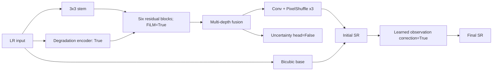

# Experiment Model Card: sentinel-delhi-observation-v1

## Purpose and lineage

- Why this experiment was run: Test whether a learned observation operator addresses the v0.1 fixed-bicubic consistency regression.
- Previous experiment/connection: Degradation variant; learned re-observation and bounded correction are added.
- Scale: exact native 3x
- Trainable parameters: 112,455
- Degradation adaptation: True
- Learned observation consistency: True
- Spatial uncertainty: False

## Mathematical forward function

\[
f_0=C_{3\times3}(x),\qquad
h_i=P_{2,i}(\operatorname{GELU}(D_i(\operatorname{GELU}(P_{1,i}(f_{i-1}))))),
\]

\[
f_i=f_{i-1}+s_i h_i\odot\sigma(G_i(h_i)),\qquad
\hat y_0=\operatorname{Bicubic}_3(x)+\operatorname{PixelShuffle}_3(C_r(f)).
\]

\(\bar h_i=(1+\gamma_i(z))\odot h_i+\beta_i(z)\) (degradation-conditioned FiLM).

\(k_z=\operatorname{softmax}(W_kz),\;\tilde x=\downarrow_3(k_z*\hat y_0),\;\hat y=\hat y_0+\alpha(z)\operatorname{Bicubic}_3(x-\tilde x),\;0\le\alpha\le0.25\).

The training objective and degradation equations are frozen in `docs/research/model-and-experiment-methodology.md` and instantiated by the exact configuration below.

## Architecture figure



## Top-level layers and parameters

| Name | Layer/module | Parameters |
|---|---|---:|
| `encoder` | DegradationEncoder | 34,004 |
| `shallow` | Conv2d | 896 |
| `blocks` | ModuleList | 51,126 |
| `fusion` | Sequential | 15,424 |
| `reconstruction` | Sequential | 7,803 |
| `observation` | LearnedObservationOperator | 2,401 |
| `consistency_gate` | Sequential | 801 |

## Activations and rationale

| Activation | Module count | Why used |
|---|---:|---|
| GELU | 25 | Smooth feature transformation; preserves small negative evidence. |
| Sigmoid | 8 | Bounds gates, severities, or uncertainty to [0,1]. |

PixelShuffle is a deterministic tensor rearrangement, not an activation. For RGB x3, the preceding convolution predicts 3x3²=27 sub-pixel channels.

## Exact configuration

```yaml
seed: 42
scale: 3
model:
  channels: 32
  num_blocks: 6
  embed_dim: 48
  kernel_size: 7
  use_degradation_adaptation: true
  use_observation_consistency: true
  use_uncertainty: false
data:
  crop_size: 120
  train_ratio: 0.8
  split_grid_degrees: 0.1
  extensions:
  - .png
training:
  epochs: 30
  batch_size: 32
  validation_batch_size: 32
  workers: 2
  learning_rate: 0.0002
  weight_decay: 0.0001
  amp: true
loss:
  charbonnier: 1.0
  ssim: 0.1
  gradient: 0.03
  frequency: 0.02
  observation: 0.05
  degradation: 0.02
  uncertainty: 0.02
  distillation: 0.0
inference:
  tile_size: 512
  overlap: 32
```

## References

- Swin2SR: https://arxiv.org/abs/2209.11345
- GELU: https://arxiv.org/abs/1606.08415
- FiLM: https://arxiv.org/abs/1709.07871
- PixelShuffle/sub-pixel convolution: https://arxiv.org/abs/1609.05158
- Canonical project methodology: `docs/research/model-and-experiment-methodology.md`


<!-- GENERATED_RESULTS_START -->
## Measured training result

Checkpoint selection rule: maximum validation PSNR. These values come directly from `metrics.csv`.
Training duration: Not recorded.

| Checkpoint row | Epoch | train_loss | psnr | ssim | false_edge_rate | observation_l1 |
|---|---:|---:|---:|---:|---:|---:|
| Best | 28 | 0.08979235083246842 | 23.90069986272741 | 0.6579641942624692 | 0.12663322825122764 | 0.04471172147464973 |
| Final | 30 | 0.08984044041389073 | 23.900208049350315 | 0.6580330287968671 | 0.12671214121359367 | 0.044706351572164786 |
<!-- GENERATED_RESULTS_END -->
