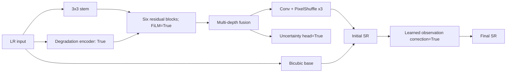
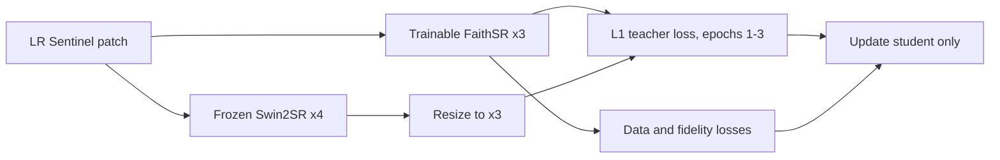

# Experiment Model Card: distilled

## Purpose and lineage

- Why this experiment was run: Transfer a pinned pretrained Swin2SR prior for three warm-start epochs, then personalize the custom student to Sentinel RGB evidence.
- Previous experiment/connection: Full Sentinel v1 student; same deployed architecture, with a temporary frozen teacher loss added.
- Scale: exact native 3x
- Trainable parameters: 117,224
- Degradation adaptation: True
- Learned observation consistency: True
- Spatial uncertainty: True

## Mathematical forward function

\[
f_0=C_{3\times3}(x),\qquad
h_i=P_{2,i}(\operatorname{GELU}(D_i(\operatorname{GELU}(P_{1,i}(f_{i-1}))))),
\]

\[
f_i=f_{i-1}+s_i h_i\odot\sigma(G_i(h_i)),\qquad
\hat y_0=\operatorname{Bicubic}_3(x)+\operatorname{PixelShuffle}_3(C_r(f)).
\]

\(\bar h_i=(1+\gamma_i(z))\odot h_i+\beta_i(z)\) (degradation-conditioned FiLM).

\(k_z=\operatorname{softmax}(W_kz),\;\tilde x=\downarrow_3(k_z*\hat y_0),\;\hat y=\hat y_0+\alpha(z)\operatorname{Bicubic}_3(x-\tilde x),\;0\le\alpha\le0.25\).

\(u=\operatorname{Bilinear}_3(\sigma(C_{u2}(\operatorname{GELU}(C_{u1}(f)))))\).

The training objective and degradation equations are frozen in `docs/research/model-and-experiment-methodology.md` and instantiated by the exact configuration below.

## Architecture figure



## Top-level layers and parameters

| Name | Layer/module | Parameters |
|---|---|---:|
| `encoder` | DegradationEncoder | 34,004 |
| `shallow` | Conv2d | 896 |
| `blocks` | ModuleList | 51,126 |
| `fusion` | Sequential | 15,424 |
| `reconstruction` | Sequential | 7,803 |
| `observation` | LearnedObservationOperator | 2,401 |
| `consistency_gate` | Sequential | 801 |
| `uncertainty` | Sequential | 4,769 |

## Activations and rationale

| Activation | Module count | Why used |
|---|---:|---|
| GELU | 26 | Smooth feature transformation; preserves small negative evidence. |
| Sigmoid | 9 | Bounds gates, severities, or uncertainty to [0,1]. |

PixelShuffle is a deterministic tensor rearrangement, not an activation. For RGB x3, the preceding convolution predicts 3x3²=27 sub-pixel channels.

## Exact configuration

```yaml
seed: 42
scale: 3
model:
  channels: 32
  num_blocks: 6
  embed_dim: 48
  kernel_size: 7
  use_degradation_adaptation: true
  use_observation_consistency: true
  use_uncertainty: true
data:
  crop_size: 120
  train_ratio: 0.8
  split_grid_degrees: 0.1
  extensions:
  - .png
training:
  epochs: 30
  batch_size: 32
  validation_batch_size: 32
  workers: 2
  learning_rate: 0.0002
  weight_decay: 0.0001
  amp: true
  teacher_batch_size: 2
  teacher_max_epoch: 3
loss:
  charbonnier: 1.0
  ssim: 0.1
  gradient: 0.03
  frequency: 0.02
  observation: 0.05
  degradation: 0.02
  uncertainty: 0.02
  distillation: 0.05
inference:
  tile_size: 512
  overlap: 32
```

## Pretrained personalization function

The pinned teacher is frozen, so it contributes no trainable parameters to deployment:

\[
T_3(x)=\operatorname{Resize}_{3/4}(T_{\mathrm{Swin2SR-x4}}(x)),
\qquad \mathcal L_{KD}=\lVert f_\theta(x)-T_3(x)\rVert_1.
\]

For epochs 1–3 the student minimizes \(\mathcal L_{full}+0.05\mathcal L_{KD}\); epochs 4–30 use \(\mathcal L_{full}\) only. The explicit resize reconciles the teacher's x4 scale with the exact x3 requirement. Short-lived low-weight supervision transfers a prior without making deployment depend on the large teacher or allowing its domain mismatch to dominate.



## Measured result and decision

- Held-out evaluation: 1,728 images from 14 geographic groups.
- Distilled student: 24.19109 dB PSNR, 0.65754 SSIM, 0.13142 false-edge rate, 0.07522 rad SAM, 8.35574 ERGAS.
- Paired PSNR gain over bicubic: +1.84381 dB, 95% geographic-cluster CI +1.69050 to +1.99713.
- Unadapted Swin2SR x4 output resized to x3: 19.67141 dB PSNR and 0.45800 SSIM, below bicubic at 22.36519 dB.
- Distilled versus non-distilled Full student: approximately +0.00004 dB PSNR, an effectively neutral result.

This experiment connects directly to Full Sentinel v1 by changing only the temporary training-time teacher term. It demonstrates a reproducible personalization path, but not a material distillation improvement; the teacher is therefore not part of inference.

## References

- Swin2SR: https://arxiv.org/abs/2209.11345
- GELU: https://arxiv.org/abs/1606.08415
- FiLM: https://arxiv.org/abs/1709.07871
- PixelShuffle/sub-pixel convolution: https://arxiv.org/abs/1609.05158
- Canonical project methodology: `docs/research/model-and-experiment-methodology.md`
