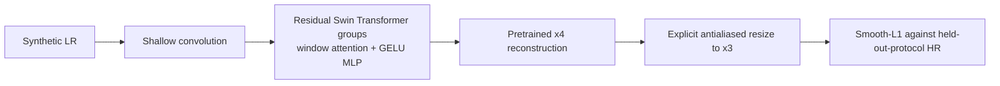

# Model Card: Fully Fine-Tuned Swin2SR x4-to-x3 Baseline

## Role and necessity

This is a strong external baseline, not the proposed FaithSR architecture. Every parameter of pinned pretrained `caidas/swin2SR-classical-sr-x4-64` at revision `c69ef3e2d2ac5777ff4a9f2f5afcd86d20604b7e` is trainable. It tests whether ordinary full fine-tuning of a much larger pretrained model is stronger than the custom native-x3 student.

## Mathematical function

For LR input `x`, pretrained Swin2SR produces an x4 reconstruction, then a declared antialiased bicubic operator maps it to the required x3 target size:

`y_hat = Resize_(3H,3W)(Swin2SR_x4(x))`.

All 12,239,283 parameters minimize `SmoothL1(y_hat, y)` for 3 epochs with AdamW learning rate 1e-05. The resize is not hidden and this baseline is never called native x3.

## Layers and activations

Swin2SR uses shallow convolutional embedding, residual Swin Transformer groups with shifted-window self-attention, GELU MLPs, layer normalization, convolutional residual connections, and an x4 sub-pixel reconstruction head. GELU is inherited from the published pretrained architecture because its smooth gating is standard inside transformer MLPs. PixelShuffle is inherited for x4 reconstruction; antialiased bicubic resize is required only to satisfy the externally fixed x3 comparison size.

## Interpretation rule

Frozen and fully fine-tuned results use the same scene-separated validation files and degradation records. A visually pleasing example cannot replace the saved per-image table, paired scene-cluster intervals, or negative failure cases.

## References

- Conde et al., “Swin2SR: SwinV2 Transformer for Compressed Image Super-Resolution and Restoration,” ECCV Workshops 2022: https://arxiv.org/abs/2209.11345
- Immutable model configuration used here: https://huggingface.co/caidas/swin2SR-classical-sr-x4-64/blob/c69ef3e2d2ac5777ff4a9f2f5afcd86d20604b7e/config.json
- Project architecture and experiment rationale: `docs/research/model-and-experiment-methodology.md`
