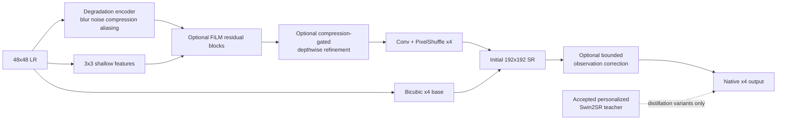

# FaithSR-Lite-X4 Personalized Compression-Aware Ablation Pre-registration

Status: frozen before remote GPU execution

Date: 2026-09-13

Previous experiment: accepted `swin2sr-native-x4-diagnostic-v2`

## Evidence-driven question

The personalized 12.24M-parameter Swin2SR teacher improves overall native-x4 fidelity but takes 3.419 seconds model-only P95 for 512x512 input on Tesla P100. Its compression-heavy PSNR advantage over bicubic is only +0.0193 dB with a 95% scene-cluster interval crossing zero. The next experiment therefore asks:

> Can a compact native-x4 student retain useful personalized-teacher fidelity, process a 512x512 tile below one second, and improve the compression-heavy failure without increasing hallucinated edges or LR observation mismatch?

This is not a generic request to add more architecture. Mamba/global-context is excluded from this ablation because no dominant long-range failure was measured and additional sequential/global blocks could worsen latency.

## Four matched variants

| Variant | Personalized teacher | Degradation FiLM | Compression gate | Observation correction | Purpose |
|---|---:|---:|---:|---:|---|
| Base | No | No | No | No | Compact native-x4 control |
| Distilled | Yes | No | No | No | Isolate pretrained personalization transfer |
| Compression | No | Yes | Yes | Yes | Isolate diagnosed compression/fidelity mechanism |
| Full | Yes | Yes | Yes | Yes | Test whether both mechanisms are complementary |

All variants share channels, block count, optimizer, epochs, crop size, split, seed, and degradation curriculum. The only changes are the registered switches above. The teacher is the accepted Sentinel-personalized Swin2SR native-x4 checkpoint with SHA-256 `b6ee155e167253fd9db8335338fffba342e2af1a201a1662942aeaa1c5949c7a`.

## Student mathematical function

### Symbols in plain language

- $\mathbf{x}$: a batch of observed RGB low-resolution tiles, $B\times3\times H\times W$, normalized from 0 to 1.
- $\mathbf{z}$: a learned summary of the input's apparent degradation.
- $\hat{\mathbf{d}}=[\hat b,\hat n,\hat c,\hat a]$: predicted blur, noise, compression and aliasing, each bounded from 0 to 1.
- $\mathbf{f}_i$: low-resolution feature maps after residual block $i$.
- $\hat{\mathbf{y}}_0$: initial RGB super-resolved image, $B\times3\times4H\times4W$.
- $\hat{\mathbf{y}}$: final bounded x4 output.

### Forward calculation

The degradation encoder performs:

$$
\hat{\mathbf{d}}=\sigma\!\left(W_d\operatorname{GELU}(W_zE(\mathbf{x}))\right).
$$

Each residual block first mixes channels with a 1×1 convolution, filters each channel spatially with a 7×7 depthwise convolution, and mixes channels again. In compact form:

$$
\mathbf{r}_i=P_{2,i}\!\left(\operatorname{GELU}\!\left(D_{7\times7,i}\!\left(\operatorname{GELU}\!\left(P_{1,i}(\mathbf{f}_{i-1})\right)\right)\right)\right).
$$

For adaptive variants, FiLM converts `z` into a channel-wise scale and shift, while a sigmoid gate decides how much of the residual is safe to add:

$$
\mathbf{f}_i=\mathbf{f}_{i-1}+s_i
\left[(1+\boldsymbol{\gamma}_i(\mathbf{z}))\odot\mathbf{r}_i+\boldsymbol{\beta}_i(\mathbf{z})\right]
\odot\sigma(G_i(\mathbf{r}_i)).
$$

The compression branch multiplies its correction by predicted compression severity. It therefore contributes less when compression is estimated to be low:

$$
\mathbf{f}_C=\mathbf{f}+s_C\hat c\,\sigma(W_C\mathbf{z})\odot
P_C\!\left(\operatorname{GELU}(D_C(\mathbf{f}))\right).
$$

The initial reconstruction is:

$$
\hat{\mathbf{y}}_0=B_4(\mathbf{x})+\operatorname{PixelShuffle}_4(C_R(\mathbf{f}_C)).
$$

For observation-enabled variants, a Softmax kernel blurs and downsamples `y0` back to the LR grid, producing `x_reobserved`. The mismatch is enlarged and added with a strength limited to 0.20:

$$
\tilde{\mathbf{x}}=\downarrow_4(\mathbf{k}_{\mathbf{z}}*\hat{\mathbf{y}}_0),
$$

$$
\hat{\mathbf{y}}=\operatorname{clip}\!\left(
\hat{\mathbf{y}}_0+\alpha(\mathbf{z})B_4(\mathbf{x}-\tilde{\mathbf{x}}),0,1\right),
\qquad 0\leq\alpha\leq0.20.
$$

`bounded_strength` is between 0 and 0.20. This bound prevents an unrestricted correction branch from inventing arbitrary high-resolution content.

## Layers and activation rationale

- Shallow 3x3 convolution: local radiometric feature extraction at low cost.
- Pointwise-depthwise-pointwise residual blocks: channel mixing plus spatial filtering with fewer parameters than dense convolutions.
- GELU: smooth feature transform that retains small negative evidence; used consistently in encoder, residual MLP-like paths, and compression refiner.
- Sigmoid: bounds degradation predictions, attention gates, compression gates, and correction strength.
- Softmax: constrains observation-kernel coefficients to be positive and sum to one.
- PixelShuffle x4: learned native reconstruction by deterministic channel rearrangement, with no x4-to-x3 resize.
- No uncertainty head: the previous native-L2A uncertainty correlation was negative, so it is excluded until a separately calibrated design is justified.

## Training objective

Every variant uses ground-truth Charbonnier, SSIM, gradient, and frequency terms. For compression variants, a sample with compression severity `c` receives reconstruction weight `1 + compression_weight × c`. Half of their training observations are stratified into the upper 20% of the active compression-severity curriculum.

The complete registered loss is:

$$
\mathcal{L}=\mathcal{L}_{\mathrm{Char},c}
+0.10\mathcal{L}_{\mathrm{SSIM}}
+0.03\mathcal{L}_{\nabla}
+0.02\mathcal{L}_{\mathrm{FFT}}
+0.05\mathcal{L}_{\mathrm{obs}}
+0.02\mathcal{L}_{\mathrm{deg}}
+0.05\mathcal{L}_{\mathrm{teacher}}
+0.01\mathcal{L}_{\mathrm{teacher\text{-}edge}}.
$$

Observation and degradation terms are zero when those modules are absent. Teacher terms are zero for non-distilled variants.

The earlier x3 distillation was neutral. This experiment differs only where the diagnosis justifies it: the teacher is Sentinel-personalized, teacher and student outputs are directly aligned at native x4, supervision spans all epochs, and compression cases are explicitly stratified.

## Frozen data and evaluation

- Same six public Sentinel-2 L2A scenes and 86 content-screened 8-bit RGB tiles.
- Same seed-0 complete-scene split: 39 training and 47 held-out tiles from three validation scene parents.
- 192x192 HR / 48x48 LR native-x4 pairs.
- Seven unchanged stress profiles and 329 paired cases per variant.
- Metrics: PSNR, SSIM, LPIPS, false-edge, edge precision/recall, SAM, x4 ERGAS, and re-observation L1.
- Deterministic worst/median/best PNG+JSON for every variant.
- 512x512-to-2048x2048 FP32/FP16 model-only latency: 10 warm-ups, 100 synchronized runs, P95 and peak VRAM.
- Full variant also receives three disk-backed TIFF pipeline timings and metadata audits per precision.

## Acceptance and decision rules

The candidate advances only if:

1. model-only P95 is below 1,000 ms on the declared hardware;
2. compression-heavy PSNR scene-cluster CI is positive versus bicubic or improves materially versus Base without worsening overall false-edge rate or re-observation L1;
3. any claimed distillation gain is supported by Distilled-minus-Base and Full-minus-Compression paired evidence;
4. uint8 output shape, metadata, mask, transform, and bounds pass the native-x4 TIFF audit;
5. negative worst cases remain in the saved qualitative evidence.

If Base already passes speed and Full gives no matched fidelity gain, the extra modules are rejected. If no student reaches acceptable fidelity, Swin2SR remains a teacher/reference and the next optimization must target the student architecture or deployment backend, not add unmeasured novelty.
