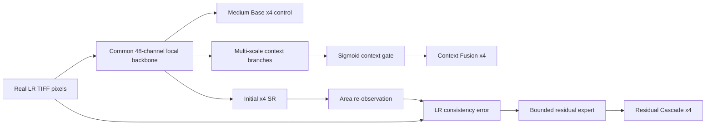

# Hybrid-X4 Controlled Comparison

Implementation status: **completed and accepted on 2026-09-14; Parallel Context Fusion selected for continuation.**

## Accepted Kaggle v1 result

The private GPU run completed successfully on CUDA using the native Sentinel-2 L2A scene-separated corpus. It evaluated 329 paired stress cases from three held-out geographic clusters. Every value below comes from the archived machine-readable output in `artifacts/training_runs/faithsr3x/hybrid_x4_controlled_v1`.

### Overall frozen-stress metrics

Lower is better for false-edge rate, LPIPS, spectral angle, ERGAS and observation L1.

| Variant | Parameters | PSNR | SSIM | False-edge | LPIPS | Observation L1 |
|---|---:|---:|---:|---:|---:|---:|
| Medium Base | 106,712 | 23.73499 | 0.62680 | 0.119440 | 0.56040 | 0.018018 |
| Parallel Context Fusion | 155,720 | **23.77394** | **0.62945** | 0.118773 | **0.55694** | **0.017624** |
| Residual Consistency Cascade | 147,732 | 23.75310 | 0.62907 | **0.118761** | 0.55987 | 0.017917 |

### Paired change versus Medium Base

The intervals are 95% normal confidence intervals over geographic-cluster mean paired image differences, not independent-patch intervals.

| Candidate | PSNR change | 95% interval | SSIM change | False-edge change | LPIPS change | Observation-L1 change |
|---|---:|---:|---:|---:|---:|---:|
| Context Fusion | **+0.03654 dB** | **+0.02649 to +0.04658** | +0.002617 | −0.000744 | −0.003809 | −0.000398 |
| Residual Cascade | +0.01697 dB | +0.01208 to +0.02185 | +0.002140 | −0.000663 | −0.000404 | −0.000092 |

Context Fusion also beat Residual Cascade by 0.01957 dB PSNR; the corresponding 95% interval was +0.01441 to +0.02473 dB. Its PSNR gain over Medium Base was positive in every stress family, although the noise-heavy gain was small (+0.00791 dB). This is evidence of consistent improvement, but the absolute gain remains modest.

### Change versus bicubic x4

| Candidate | PSNR | SSIM | False-edge | LPIPS | Observation L1 |
|---|---:|---:|---:|---:|---:|
| Medium Base | +0.03907 dB | +0.02134 | −0.000580 | −0.05955 | −0.000939 |
| Context Fusion | **+0.07561 dB** | **+0.02395** | **−0.001324** | **−0.06336** | **−0.001337** |
| Residual Cascade | +0.05603 dB | +0.02348 | −0.001243 | −0.05996 | −0.001031 |

Both hybrids therefore improved reconstruction and measured fidelity rather than merely making the image look sharper.

### 512-by-512 P100 latency

| Candidate | FP16 model P95 | FP32 model P95 | FP16 TIFF P95 | FP16 peak VRAM |
|---|---:|---:|---:|---:|
| Context Fusion | **48.44 ms** | 48.64 ms | 423.41 ms | 697,546,752 bytes |
| Residual Cascade | 51.27 ms | 51.39 ms | **398.32 ms** | **594,945,024 bytes** |

Both are far below the one-second hard gate and the 300 ms model / 800 ms TIFF safety targets. The three-run TIFF difference is dominated by disk accumulation and final writing, so it is not treated as proof that the cascade has faster inference; the 100-run model-only result is the cleaner comparison. Context Fusion is 2.83 ms faster model-only, while the cascade uses about 103 MB less measured FP16 peak VRAM.

### Decision

**Parallel Context Fusion is selected for the next experiment.** It gives the strongest PSNR, SSIM, LPIPS and observation-consistency result, its false-edge rate improves over both Medium Base and bicubic, and it keeps a very large latency margin. Residual Cascade remains useful evidence: it improves spectral SAM and ERGAS slightly more than Context Fusion, uses less VRAM, and validates that bounded re-observation correction works. It is not selected because its PSNR and perceptual gain are reliably smaller.

Visual panels show that both learned outputs remain conservative and close to bicubic rather than inventing crisp objects. Context Fusion recovers slightly more supported structure, but neither model reconstructs the unavailable held-out HR detail perfectly. The next Context Fusion experiment should therefore target data coverage and capacity, not add an adversarial or generative hallucination objective.

## Research question

FaithSR-Lite-X4 is fast (73.35 ms model-only P95 and 482.85 ms end-to-end TIFF P95 on the recorded P100 run), but its Full variant was 0.04427 dB below bicubic overall and looked too soft. Personalized Swin2SR gave better fidelity but required 3,418.60 ms model-only P95. This experiment tests two different ways to occupy the unused quality/latency space:

1. **Parallel Context Fusion:** add broad, multi-scale spatial context beside the local CNN path.
2. **Residual Consistency Cascade:** produce an initial SR result, re-observe that result at LR, and use the mismatch to drive a small bounded correction expert.

A **Medium Base** model with the same 48-channel, eight-block common backbone is trained as the scientific control. All three variants use the same seed, scene split, degradation samples, loss, optimizer and schedule. This separates architectural gains from a simple increase in base capacity.

## Input and deployment rule

The app does **not** degrade the user's input. An 8-bit TIFF is read, normalized to values from 0 to 1, passed directly to the selected model, converted back to an 8-bit TIFF, and written with audited spatial metadata. Synthetic blur, resampling, noise and compression are used only to create LR/HR supervision during training and frozen stress evaluation.

The cascade's re-observation is different from degrading the input: it downsamples its own first SR estimate to ask whether that estimate remains compatible with the real LR observation.

## Common mathematical model

In human-readable form, the input has `batch x bands x height x width` values:

$$
X \in [0,1]^{B \times C \times H \times W}.
$$

The shallow feature map is:

$$
F_0 = C_{3\times3}(X).
$$

Each efficient residual block applies depthwise and pointwise convolutions with GELU, then adds a learned residual whose initial scale is 0.1:

$$
F_i = F_{i-1} + s_i\,C_{1\times1}\left(DW_{3\times3}\left(\operatorname{GELU}\left(C_{1\times1}\left(\operatorname{GELU}\left(DW_{3\times3}(F_{i-1})\right)\right)\right)\right)\right).
$$

Outputs from all eight blocks are concatenated and fused:

$$
F = F_0 + C_{3\times3}\left(\operatorname{GELU}\left(C_{1\times1}([F_1,\ldots,F_8])\right)\right).
$$

The common native-x4 reconstruction is:

$$
\widehat{Y}_0 = \operatorname{Bicubic}_4(X) + \operatorname{PixelShuffle}_4(C_r(F)).
$$

PixelShuffle is a deterministic rearrangement, not an activation. For RGB x4, the preceding convolution predicts `3 x 4² = 48` channels.

## Approach 1: Parallel Context Fusion

Three branches examine the LR feature map at full, half and quarter spatial resolution. Depthwise 7-by-7 convolution supplies a broad receptive field without expensive HR processing. After upsampling and mixing the branch outputs:

$$
C = \operatorname{Mix}\left(\operatorname{Concat}(B_1(F),B_2(F),B_3(F))\right).
$$

A spatial and channel-wise sigmoid gate decides where the context is supported:

$$
G = \operatorname{Sigmoid}\left(C_{1\times1}\left(\operatorname{GELU}\left(C_{1\times1}([F,C])\right)\right)\right),
$$

$$
F_{\mathrm{fused}} = F + G \odot C.
$$

The final result is reconstructed from the fused feature. The expected benefit is better roads, field boundaries and larger structures. The risk is that broad context may spread a false structure across neighbouring pixels.

## Approach 2: Residual Consistency Cascade

The first result is re-observed using fixed area downsampling:

$$
\widetilde{X}_0 = \operatorname{AreaDownsample}_4(\widehat{Y}_0),
\qquad E = X - \widetilde{X}_0.
$$

A three-block expert receives the real LR input and the re-observation error. It predicts a high-resolution residual and a scalar gate per image:

$$
\Delta Y = R_{\theta}([X,E]),
$$

$$
A = 0.15\,\operatorname{Sigmoid}(G_{\theta}(R_{\theta}([X,E]))),
$$

$$
\widehat{Y} = \widehat{Y}_0 + A \odot \Delta Y.
$$

The 0.15 maximum is a deliberate hallucination guardrail. The expected benefit is targeted correction of output that is inconsistent with the observed LR pixels. The trade-off is a second LR feature pass, so latency is expected to be higher than the parallel-context model.

## Activation functions and reasons

GELU is used in feature transformations:

$$
\operatorname{GELU}(u) = u\,\Phi(u).
$$

It is smooth and preserves small negative evidence, which is useful for residual optimization. Sigmoid is used only where a value must be bounded:

$$
\operatorname{Sigmoid}(u) = \frac{1}{1+e^{-u}}.
$$

It bounds context gates from 0 to 1 and cascade correction strength from 0 to 0.15. GAN and diffusion losses are excluded because visual realism can reward geographic details unsupported by the input.

## Loss function

Every variant minimizes the same loss:

$$
\mathcal{L} = \mathcal{L}_{\mathrm{Charbonnier}} + 0.10\mathcal{L}_{\mathrm{SSIM}} + 0.03\mathcal{L}_{\mathrm{gradient}} + 0.02\mathcal{L}_{\mathrm{frequency}} + 0.05\mathcal{L}_{\mathrm{observation}}.
$$

The observation term uses fixed area re-observation for every variant, preventing a loss-function advantage for the cascade:

$$
\mathcal{L}_{\mathrm{observation}} = \left\|\operatorname{AreaDownsample}_4(\widehat{Y}) - X\right\|_1.
$$

## Layers and code-to-equation mapping

| Mathematical item | Code | Reason |
|---|---|---|
| $F_i$ | `EfficientResidualBlock.forward` in `src/faithsr/hybrid_x4.py` | Efficient local processing on the LR grid |
| $C$ and $G$ | `MultiScaleContextBranch.forward` | Parallel multi-scale context plus bounded fusion |
| $E$, $\Delta Y$ and $A$ | `ResidualConsistencyExpert.forward` | Second-stage correction based on output/input compatibility |
| $\widehat{Y}$ | `HybridFaithSRX4.forward` | Complete native-x4 forward function |
| $\mathcal{L}$ | `CompressionAwareObjective.forward` in `src/faithsr/losses.py` | Common reconstruction and fidelity objective |
| Training loop | `src/faithsr/hybrid_x4_train.py` | Identical controlled schedule for all variants |
| Frozen evaluation | `src/faithsr/hybrid_x4_evaluate.py` | Paired metrics, uncertainty intervals, latency and panels |

## Architecture figure

## Frozen dataset and protocol

- Primary dataset: native Sentinel-2 L2A TIFF patches with scene-separated train/validation groups.
- Training crop: 192-by-192 HR; native scale: x4.
- Training: 60 epochs, AdamW, cosine learning-rate schedule and AMP.
- Frozen stress families: clean, blur/MTF, noise and compression profiles already used by the native-x4 diagnostic.
- Metrics: PSNR, SSIM, false-edge rate, LPIPS, SAM, ERGAS and re-observation L1.
- Saved evidence: best checkpoint, metrics CSV, degradation manifest, model card, best training preview, and worst/median/best frozen evaluation panels for each variant.

The user-linked `gallo33henrique/sentinel-2-satellite-imagery` dataset is useful as a larger EuroSAT/Sentinel-2 source. Its class folders are well organized, but the current controlled run retains the native L2A scene-group corpus so train/validation leakage and sensor provenance stay auditable. Dataset expansion is a later registered experiment, not silently mixed into this architecture comparison.

## Latency and acceptance gates

The preferred safety targets are:

$$
t_{\mathrm{model},95} \le 300\ \mathrm{ms},
\qquad t_{\mathrm{TIFF},95} \le 800\ \mathrm{ms}.
$$

The hard requirement is below 1,000 ms P95 for one 512-by-512 block on the declared P100 environment. A hybrid is continued only if it improves the matched Medium Base and bicubic in paired evidence without a material false-edge or re-observation regression. LPIPS alone cannot select the model. The evaluator reports both model-only and end-to-end TIFF timing for each hybrid, parameter counts, geographic-cluster confidence intervals, and deterministic result panels.

## References

- Sun et al., *Spatially-Adaptive Feature Modulation for Efficient Image Super-Resolution*, ICCV 2023.
- Wang, *Edge-Enhanced Feature Distillation Network for Efficient Super-Resolution*, CVPR Workshops 2022.
- Shi et al., *Real-Time Single Image and Video Super-Resolution Using an Efficient Sub-Pixel Convolutional Neural Network*, CVPR 2016.
- Hendrycks and Gimpel, *Gaussian Error Linear Units*, 2016.

## Archived evidence

- Comparison summary: `artifacts/training_runs/faithsr3x/hybrid_x4_controlled_v1/evaluation/hybrid-comparison-summary.json`
- Per-variant model cards, metrics, checkpoints and training previews: `artifacts/training_runs/faithsr3x/hybrid_x4_controlled_v1/{medium_base,context_fusion,residual_cascade}`
- Worst/median/best frozen panels and per-image CSVs: `artifacts/training_runs/faithsr3x/hybrid_x4_controlled_v1/evaluation/<variant>/stress`
- Private Kaggle run: https://www.kaggle.com/code/muhammadhassan2/faithsr-hybrid-x4-controlled-comparison
