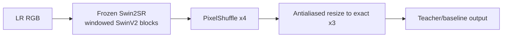
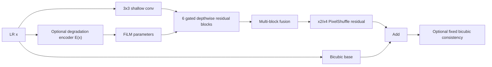
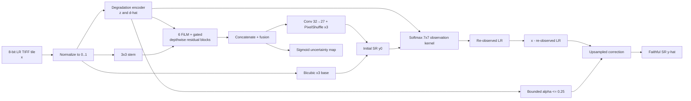
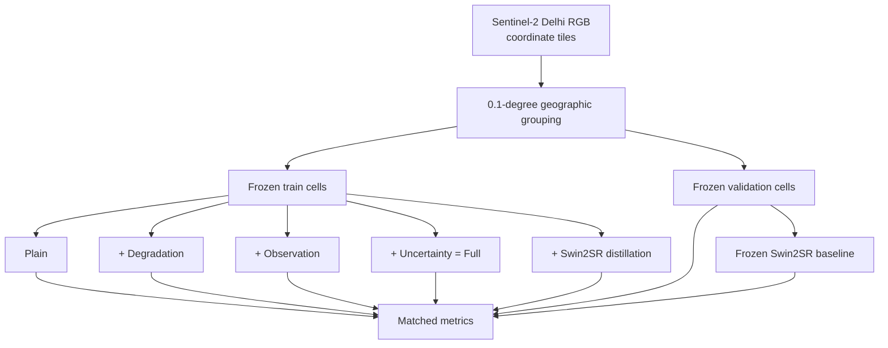
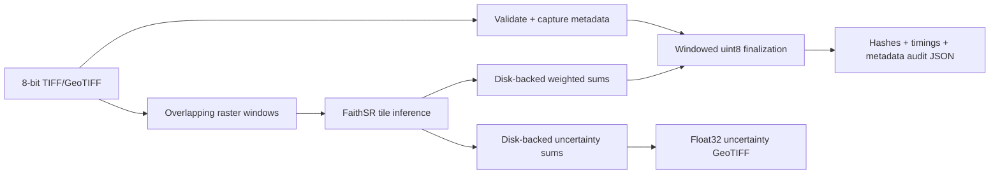
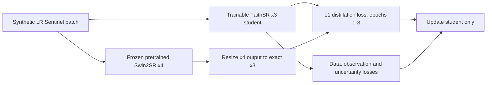

# FaithSR Model and Experiment Methodology

Status: Living technical record. Results are claims only where an immutable artifact is linked.

Last updated: 2026-09-09

## Documentation rule for every experiment

Har future experiment ki entry mein yeh cheezen mandatory hain:

1. hypothesis aur experiment karne ki zaroorat;
2. previous experiment se exact connection;
3. dataset/version, split rule, seed aur manifest hash;
4. model ka mathematical forward function;
5. layer-by-layer architecture aur parameter count;
6. activation functions aur unko choose karne ki wajah;
7. loss function with weights;
8. architecture/data-flow figure in Mermaid;
9. hardware, duration, checkpoint-selection rule aur metrics;
10. result, negative result, limitation aur next decision;
11. code/config/checkpoint/result references.

Is template ka maqsad yeh hai ke thesis mein sirf “model train kiya” na likha ho; har design decision traceable aur defendable ho.

The trainer enforces this practice by generating a `model-card.md` inside every new run directory. Researchers pass `--experiment-rationale` and `--previous-experiment`; the card derives active components, layer parameter counts, activations, equations, Mermaid flow, and exact YAML directly from the instantiated model/config. Canonical hand-written interpretation in this document is still required after results arrive.

## Experiment lineage

Roman Urdu explanation: Swin2SR ne strong pretrained reference diya, lekin woh project ki apni architecture nahi thi. Is liye v0.1 lightweight custom model banaya gaya. v0.1 ke small degradation gains aur weaker observation-consistency result ne native 3x model, richer degradation vector aur learned observation operator ki zaroorat establish ki. EuroSAT run ne implementation/convergence verify ki; Sentinel experiment ab geographic generalization aur component attribution test karta hai. SUPARCO holdout last external-validity gate hai.

## Notation

- (x \in [0,1]^{B\times C\times H\times W}): normalized low-resolution input.
- (y \in [0,1]^{B\times C\times 3H\times 3W}): high-resolution target.
- \(\hat y=f_\theta(x)\): model reconstruction.
- (z=E_\phi(x)): degradation embedding.
- (d\): normalized synthetic degradation parameters.
- (D_z(\hat y)): learned, degradation-conditioned observation operator that maps SR back to LR.
- (u\in[0,1]^{B\times1\times3H\times3W}): predicted uncertainty/risk.

## Shared synthetic observation model

The native 3x experiments create an LR observation as

\[
x = Q_8\left(J_q\left(\mathcal{N}_{g,p}\left(\downarrow_3\left(k_{\sigma_x,\sigma_y,\alpha} * y\right)\right)\right)\right),
\]

where (k) is a normalized rotated anisotropic Gaussian kernel, \(\downarrow_3\) is antialiased bicubic or bilinear decimation, \(\mathcal{N}_{g,p}\) combines Gaussian and optional Poisson noise, (J_q) is a JPEG round trip at quality (q\), and (Q_8(v)=\operatorname{round}(255\operatorname{clip}(v,0,1))/255\) is 8-bit quantization.

Why this function: sirf clean bicubic downsampling par training real TIFF/JPEG inputs ke blur, noise, compression aur aliasing ko represent nahi karti. Random parameters exact seed ke sath JSON mein record hote hain, is liye validation degradation replayable hai. Yeh still synthetic model hai; real sensor MTF ka substitute claim nahi kiya jata.

Code: [`src/faithsr/degradation.py`](../../src/faithsr/degradation.py)

## Pretrained Swin2SR reference

### Role

Swin2SR x4 ko do roles diye gaye:

- strong pretrained inference baseline;
- frozen teacher for student distillation.

It is not presented as the proposed model. The pinned baseline is `caidas/swin2SR-classical-sr-x4-64` at revision `c69ef3e2d2ac5777ff4a9f2f5afcd86d20604b7e`. It contains about 12.2 million parameters and produces x4 output. For the fixed x3 task, its result is antialiased-bicubic resized:

\[
t_3(x)=\mathcal{R}_{3H,3W}\left(f_{\text{Swin2SR-x4}}(x)\right).
\]

Why resize rather than claim native x3: available checkpoint x4 hai. Resize explicitly document karne se comparison reproducible rehta hai aur x4 output ko ghalat taur par native x3 nahi kaha jata. A native/fine-tuned x3 pretrained baseline future stronger comparison hai.

The supplied UC Merced fine-tuned checkpoint is an x4 `Swin2SRForImageSuperResolution` state dictionary. It remains an historical qualitative artifact; it is not silently loaded into a mismatched x3 architecture.

### Supplied qualitative Swin2SR experiment

Why it was run: pretrained transformer ki practical visual capability dekhna aur custom model ke liye strong-reference direction choose karna. Connection: is experiment ne prove nahi kiya ke model project ka apna contribution hai; isi limitation se FaithSR v0.1 start hua.

Existing figures:

- [field LR versus Swin2SR](../../artifacts/results/figures/field_lr_vs_swin2sr.png)
- [field fine-tuning comparison](../../artifacts/results/figures/field_finetune_comparison.png)
- [field method comparison](../../artifacts/results/figures/field_method_comparison.png)
- [airplane method comparison](../../artifacts/results/figures/airplane_method_comparison.png)
- [field real-x4 comparison](../../artifacts/results/figures/field_real_x4_comparison.png)

Interpretation rule: yeh selected qualitative examples architecture feasibility show karte hain, dataset-level superiority nahi. Exact split/metric manifest supplied nahi tha, is liye paper mein in figures ko quantitative evidence ke taur par use nahi karna.

References: [Swin2SR paper](https://arxiv.org/abs/2209.11345), [pinned Hugging Face model](https://huggingface.co/caidas/swin2SR-classical-sr-x4-64/tree/c69ef3e2d2ac5777ff4a9f2f5afcd86d20604b7e).

## FaithSRNet v0.1 experiments

### Why v0.1 was needed

Pretrained Swin2SR se result mil sakta tha, lekin FYP contribution explainable/custom nahi banti. v0.1 ne lightweight CNN, degradation conditioning aur observation consistency ke hypotheses ko independently test kiya.

### v0.1 forward function

For shallow features (f_0=C_{3\times3}(x)\), six residual blocks compute

\[
r_i = C^{(i)}_{1\times1,\downarrow}\left(\operatorname{GELU}\left(C^{(i)}_{3\times3,dw}\left(\operatorname{GELU}(C^{(i)}_{1\times1,\uparrow}(f_{i-1}))\right)\right)\right),
\]

\[
\tilde r_i=(1+\gamma_i(z))\odot r_i+\beta_i(z),\qquad
f_i=f_{i-1}+s_i\,\tilde r_i\odot\sigma(g_i(\tilde r_i)),
\]

where FiLM terms \(\gamma,\beta\) are absent in the Base variant. Intermediate outputs are fused, PixelShuffle reconstructs a residual, and bicubic interpolation supplies a stable base:

\[
\hat y_0=\operatorname{Bicubic}_s(x)+U_s(F([f_1,\ldots,f_6])+f_0).
\]

The old observation-consistency variant used a fixed bicubic operator:

\[
\hat y=\hat y_0+\alpha(z)\operatorname{Bicubic}_s\left(x-\operatorname{BicubicDown}(\hat y_0)\right).
\]

### v0.1 layers

| Stage | Layer | Purpose and reason |
|---|---|---|
| Degradation encoder | 3 strided 3x3 convolutions: 3→16→32→48, GELU, global average pool, 48→64 linear | Compact global blur/noise/compression context without requiring metadata. |
| Shallow feature | 3x3 convolution, 3→48 | Local spatial evidence ko feature space mein map karta hai. |
| Six residual blocks | 1x1 expansion, 3x3 depthwise, 1x1 projection, FiLM, channel gate | Depthwise separable design compute kam rakhta; residual path training stable rakhta. |
| Fusion | concat six outputs, 1x1 reduction, GELU, 3x3 convolution | Sirf last block par depend karne ke bajaye shallow/deep evidence reuse hota hai. |
| Upsampler | one/two Conv→PixelShuffle(2) stages | v0.1 x2/x4 ke liye efficient sub-pixel reconstruction. |
| Consistency gate | 64→16→1 MLP, GELU then sigmoid | Per-image correction strength ko bounded \([0,1]\) rakhta hai. |

### v0.1 experiment connection and result

| Experiment | Parameters | Why it was run | Connection | Complex PSNR / SSIM | Decision |
|---|---:|---|---|---:|---|
| Base x4 | 272,769 | Establish custom lightweight reference without degradation conditioning. | First custom model after Swin2SR reference. | 24.6625 / 0.6502 | Valid base. |
| Base + DA x4 | 334,484 | Test whether input-estimated degradation improves mixed blur/noise/JPEG reconstruction. | Adds encoder + FiLM to Base only. | 24.6759 / 0.6520 | Gain positive but too small for contribution claim. |
| Base + DA + AOC x4 | 335,541 | Test whether output can be pulled back toward observed LR data. | Adds fixed bicubic correction to DA. | 24.6082 / 0.6471 | Regression; fixed operator likely mismatched unknown degradation. Replace it. |

This negative result directly motivated a learned observation operator in FaithSR-3X. Source: [`src/faithsr_v01/faithsrnet_v01.py`](../../src/faithsr_v01/faithsrnet_v01.py); immutable results: [`experiment-log.md`](experiment-log.md).

Per-experiment cards: [Base x4](model-cards/faithsr-v01-base-x4.md), [Degradation-Adaptive x4](model-cards/faithsr-v01-da-x4.md), and [DA + Observation x4](model-cards/faithsr-v01-full-x4.md). The external teacher/baseline has a separate [pinned Swin2SR card](model-cards/swin2sr-pretrained-reference.md).

## FaithSR-3X architecture

### Why a new architecture was required

The confirmed output is exactly x3, whereas v0.1 was x2/x4. The v0.1 degradation target lacked aliasing, its observation operator was fixed bicubic, and it had no spatial uncertainty. FaithSR-3X addresses those specific gaps while remaining much smaller than Swin2SR.

### Layer-by-layer definition (EuroSAT/Sentinel configuration)

| Stage | Exact layer sequence | Output/purpose | Why this design |
|---|---|---|---|
| Degradation encoder | Conv3x3/s2 3→24 → GELU → Conv3x3/s2 24→40 → GELU → Conv3x3/s2 40→56 → GELU → adaptive average pool → Linear 56→48 → GELU | Embedding \(z\in\mathbb{R}^{48}\); auxiliary 4-vector via 48→32→4 sigmoid | Three strided layers cheaply enlarge receptive field; global pool accepts arbitrary tile size; four targets represent blur, noise, compression, aliasing. |
| Shallow stem | Conv3x3 3→32 | \(f_0\) | Preserves full LR grid and local evidence. |
| Six adaptive blocks | Conv1x1 32→64 → GELU → depthwise Conv3x3 64→64 → GELU → Conv1x1 64→32; FiLM 48→64; squeeze gate 32→8→32 sigmoid; learnable residual scale initialized 0.1 | Conditioned residual refinement | Expansion increases channel mixing; depthwise convolution lowers MACs; small initial residual scale keeps early training near identity. |
| Fusion | concatenate 6×32 → Conv1x1 192→32 → GELU → Conv3x3 32→32; add \(f_0\) | Reuses all block depths | Dense history improves feature reuse without a large transformer. |
| Native reconstruction | Conv3x3 32→27 → PixelShuffle(3) | RGB residual at 3H×3W | 27=3×3² channels gives exact single-stage x3 rearrangement without cascaded rounding. |
| Learned observation | Linear 48→49 → softmax, producing a positive normalized 7x7 kernel; unfold/convolution; average-pool3 | \(D_z(\hat y)\) | Positive unit-sum kernel behaves like a plausible blur and avoids unconstrained amplification. |
| Consistency gate | Linear 48→16 → GELU → Linear16→1 → sigmoid, multiplied by 0.25 | \(\alpha\in[0,0.25]\) | Correction bounded hai; LR evidence model output ko dominate nahi kar sakta. |
| Uncertainty head | Conv3x3 32→16 → GELU → Conv3x3 16→1 → sigmoid → bilinear x3 | Spatial risk \(u\in[0,1]\) | One-channel bounded risk map analyst ko questionable areas dikhata hai with small parameter overhead. |

Parameter counts for matched 32-channel variants:

| Variant | DA | Learned observation | Uncertainty | Parameters |
|---|---:|---:|---:|---:|
| Plain | No | No | No | 56,433 |
| Degradation | Yes | No | No | 109,253 |
| Observation | Yes | Yes | No | 112,455 |
| Full | Yes | Yes | Yes | 117,224 |
| Distilled | Yes | Yes | Yes | 117,224 student + frozen 12.2M teacher during training only |

### Forward function

The degradation encoder produces

\[
z=\operatorname{GELU}(W_z\operatorname{GAP}(E_c(x))),\qquad \hat d=\sigma(W_{d2}\operatorname{GELU}(W_{d1}z)).
\]

Each adaptive block follows

\[
h_i=P_{2,i}(\operatorname{GELU}(D_i(\operatorname{GELU}(P_{1,i}(f_{i-1}))))),
\]

\[
\bar h_i=(1+\gamma_i(z))\odot h_i+\beta_i(z),\qquad
f_i=f_{i-1}+s_i\bar h_i\odot\sigma(G_i(\bar h_i)).
\]

Native reconstruction is

\[
\hat y_0=\operatorname{Bicubic}_3(x)+\operatorname{PixelShuffle}_3(C_r(f)).
\]

The learned kernel is positive and normalized:

\[
k_z=\operatorname{softmax}(W_kz),\qquad \sum_{p,q}k_z[p,q]=1,\quad k_z[p,q]\ge 0.
\]

Observation consistency then becomes

\[
\tilde x=D_z(\hat y_0)=\downarrow_3(k_z*\hat y_0),
\]

\[
\alpha(z)=0.25\,\sigma(W_{a2}\operatorname{GELU}(W_{a1}z)),
\]

\[
\hat y=\hat y_0+\alpha(z)\operatorname{Bicubic}_3(x-\tilde x).
\]

Uncertainty is

\[
u=\operatorname{Bilinear}_3\left(\sigma(C_{u2}(\operatorname{GELU}(C_{u1}(f))))\right).
\]

Code: [`src/faithsr/model.py`](../../src/faithsr/model.py)

## Activation-function rationale

### GELU

\[
\operatorname{GELU}(a)=a\Phi(a)\approx\frac{a}{2}\left(1+\tanh\left[\sqrt{\frac{2}{\pi}}(a+0.044715a^3)\right]\right).
\]

Why used: GELU hard zero threshold nahi lagata; small negative evidence smoothly retain hoti hai. Transformer teacher bhi GELU family use karta hai, aur compact residual blocks mein smooth gradients stable optimization dete hain. ReLU bhi valid ablation ho sakti hai, lekin current choice ko novelty claim nahi kiya gaya.

### Sigmoid

\[
\sigma(a)=\frac{1}{1+e^{-a}}.
\]

Why used: degradation severities, gates aur uncertainty naturally bounded \([0,1]\) quantities hain. Consistency gate ko further 0.25 se multiply karne ka reason hallucination correction ko conservative rakhna hai. Risk: saturation gradients reduce kar sakti hai; calibration metrics isliye required hain.

### Softmax

\[
\operatorname{softmax}(a_i)=\frac{e^{a_i}}{\sum_j e^{a_j}}.
\]

Why used: learned observation kernel ke weights non-negative aur unit-sum bante hain. Yeh operator ko blur/averaging interpretation deta aur arbitrary signed sharpening kernel se unsupported detail amplification reduce karta hai.

### PixelShuffle

For scale (r=3\), PixelShuffle deterministically rearranges (C r^2\times H\times W\) channels into (C\times rH\times rW\). Is mein learned interpolation nahi hoti; preceding convolution required sub-pixels predict karti hai. It is used because exact x3 output single efficient stage mein milta hai.

References: [GELU](https://arxiv.org/abs/1606.08415), [FiLM](https://arxiv.org/abs/1709.07871), [sub-pixel convolution/PixelShuffle](https://arxiv.org/abs/1609.05158).

## Training objective

The implemented objective is

\[
\mathcal L=\lambda_c\mathcal L_{char}+\lambda_s\mathcal L_{ssim}+\lambda_g\mathcal L_{grad}+\lambda_f\mathcal L_{freq}+\lambda_o\mathcal L_{obs}+\lambda_d\mathcal L_{deg}+\lambda_u\mathcal L_{unc}+\lambda_t\mathcal L_{distill}.
\]

| Term | Mathematical definition | Why it exists |
|---|---|---|
| Charbonnier | \(\mathbb E\sqrt{(\hat y-y)^2+\epsilon^2}\), \(\epsilon=10^{-3}\) | Robust pixel fidelity; large outliers MSE se kam dominate karte hain. |
| SSIM | \(1-\operatorname{SSIM}(\hat y,y)\) using 11x11 local statistics | Local luminance/contrast/structure preserve karta hai. |
| Gradient | \(\|S(\hat y)-S(y)\|_1\), Sobel (S\) | Edges recover karta, but false-edge metric ke sath monitor hota hai. |
| Frequency | \(\||\mathcal F(\hat y)|-|\mathcal F(y)||_1\) | Spatial loss ke sath frequency-energy mismatch reduce karta hai. |
| Observation | smooth-L1 \(D_z(\hat y),x\) | Output ko actual LR measurement se consistent rakhta hai. |
| Degradation | smooth-L1 \((\hat d,d)\) | Encoder ko identifiable synthetic factors learn karwata hai. |
| Uncertainty | smooth-L1 \((u,\operatorname{mean}_c|\operatorname{stopgrad}(\hat y-y)|)\) | Risk map ko observed error magnitude ke sath calibrate karta hai. |
| Distillation | smooth-L1 \((\hat y,t_3(x))\) | Pretrained spatial prior student mein transfer hota, teacher deployment mein required nahi. |

EuroSAT/Sentinel full weights are (1.0,0.1,0.03,0.02,0.05,0.02,0.02,0.0\). Distilled run sets \(\lambda_t=0.05\). These are configuration values, universal constants nahi.

Code: [`src/faithsr/losses.py`](../../src/faithsr/losses.py). SSIM reference: [Wang et al., 2004](https://ece.uwaterloo.ca/~z70wang/publications/ssim.pdf). Realistic-degradation motivation: [Real-ESRGAN](https://arxiv.org/abs/2107.10833).

## EuroSAT native-3x experiments

### EuroSAT preliminary v8

Why run: native x3 code, deterministic degradation, AMP training, checkpointing aur uncertainty association ko affordable public 8-bit RGB data par end-to-end verify karna tha. UC Merced v0.1 x4 result ko directly reuse nahi kiya ja sakta tha because scale/operator/loss changed.

Connection: v0.1 Full ke fixed bicubic operator ko learned positive 7x7 kernel se replace kiya; degradation target 3 se 4 factors hua; uncertainty head add hui; parameter count 335,541 se 117,224 hua.

Result: 30 epochs, best epoch 25, PSNR 30.6966 dB, SSIM 0.84078, false-edge rate 0.27991, observation L1 0.05491, uncertainty/error correlation 0.28643. Exact run caveats and hashes [`experiment-log.md`](experiment-log.md) mein hain.

### Kaggle engineering-run lineage (v1-v8)

| Kernel version | Experiment/need | Previous run se connection | Outcome and lesson |
|---:|---|---|---|
| 1 | Private Git repository se package clone karna | First remote reproduction attempt | Authentication unavailable; source ko secret-free private Kaggle dataset banana pada. |
| 2 | Source dataset mount use karna | v1 clone failure removed | ZIP/unpacked mount assumption wrong; mount discovery required. |
| 3 | Correct source mount | v2 packaging fix | EuroSAT path hard-coded tha; dataset-root discovery required. |
| 4 | Dynamic data path | v3 path fix | Mounted source ko pip build karna unreliable tha; direct `PYTHONPATH` use hua. |
| 5 | Direct source import | v4 install fix | Tesla P100 (sm60) preinstalled PyTorch build se incompatible; compatible CUDA wheel pin hua. |
| 6 | P100-compatible PyTorch | v5 architecture fix | BCE uncertainty loss AMP-safe nahi tha; smooth-L1 calibration target use hua. |
| 7 | AMP-safe uncertainty | v6 loss fix | Validation batch size 1 ne runtime waste ki; deterministic batched validation add hui. |
| 8 | Batched deterministic validation | v7 efficiency fix | Complete 30-epoch run; checkpoint, split, metrics and logs preserved. |

Why record failed versions: reproducibility sirf successful command nahi hoti. Yeh lineage batati hai ke final kernel ke environment pins aur mount-discovery code arbitrary nahi, observed failures ke direct fixes hain.

### Matched interpolation evaluation v3

Why run: standalone model number se superiority prove nahi hoti. Same 6,000 deterministic samples/degradations par nearest, bilinear, bicubic aur saved FaithSR checkpoint compare kiye.

Connection: v8 checkpoint freeze karne ke baad separate kernel mein evaluation hui, isliye test-time checkpoint selection nahi hua.

| Method | PSNR | SSIM | False-edge rate | SAM (rad) | ERGAS |
|---|---:|---:|---:|---:|---:|
| Nearest | 21.3032 | 0.51278 | 0.68459 | 0.14767 | 9.08825 |
| Bilinear | 23.7156 | 0.58633 | 0.68736 | 0.10980 | 6.86787 |
| Bicubic | 22.7390 | 0.55729 | 0.69036 | 0.12514 | 7.70141 |
| FaithSR-3X | **30.6825** | **0.84060** | **0.28037** | **0.03489** | **3.18576** |

Interpretation: same synthetic generator par FaithSR interpolation se strong better hai. Yeh real unknown sensor degradation, pretrained baseline, ya SUPARCO result nahi.

Artifacts: [`artifacts/results/faithsr3x/eurosat_matched_v3/`](../../artifacts/results/faithsr3x/eurosat_matched_v3/)

## Sentinel-2 Delhi geographic ablation experiment

Status: four matched custom variants completed in Kaggle kernel v1. The distilled/pretrained stage failed before training because of a Torch/TorchVision ABI mismatch and is being rerun separately with compatible pins. Partial completion is labelled explicitly.

Dataset role: CC0 Sentinel-2 RGB display patches, 128x128 at reported 10 m/pixel, coordinate-named over Delhi NCR. It is more geographically explicit than EuroSAT but does not contain native L2A DN/quantification metadata, so it is not a replacement for the planned reflectance-controlled L2A experiment.

Split function: for coordinate ((\varphi,\lambda)\), group

\[
g(\varphi,\lambda)=\left(\left\lfloor\frac{\varphi}{0.1}\right\rfloor,\left\lfloor\frac{\lambda}{0.1}\right\rfloor\right).
\]

Entire 0.1-degree cells are assigned to train or validation. Adjacent patches from one cell cannot leak across the split.

### Matched ablation questions

| Variant | Change from previous | Why it is necessary | Expected evidence |
|---|---|---|---|
| Plain | No encoder, FiLM, observation, uncertainty | Minimum custom native-x3 control. | Backbone capacity baseline. |
| Degradation | Add encoder + FiLM | Isolate whether degradation conditioning itself helps. | Plain→DA paired gain/loss. |
| Observation | Add learned re-degradation and bounded correction | Test the mechanism motivated by v0.1 AOC failure. | DA→Observation fidelity/false-edge change. |
| Full | Add uncertainty head/loss | Test whether risk output can be added without fidelity regression. | Observation→Full plus correlation/calibration. |
| Distilled | Add frozen pinned Swin2SR target, same deployed student | Test whether pretrained knowledge personalizes the custom model rather than replacing it. | Full→Distilled fidelity trade-off. |
| Frozen Swin2SR | 12.2M pretrained x4 then explicit x3 resize | Strong external reference. | Proposed student versus pretrained model. |

Kernel: `muhammadhassan2/faithsr-3x-sentinel-delhi-ablation`. Config: [`configs/sentinel_delhi_kaggle.yaml`](../../configs/sentinel_delhi_kaggle.yaml).

### Sentinel v1 completed results

The frozen split contains 7,488 training images in 58 coordinate-grid groups and 1,728 validation images in 14 disjoint groups; group overlap is zero. All variants use seed 42, 30 epochs, identical synthetic degradation/evaluation, and best-validation-PSNR checkpoint selection.

| Variant | Best epoch | Params | PSNR | SSIM | False-edge | SAM (rad) | ERGAS | UQ corr. |
|---|---:|---:|---:|---:|---:|---:|---:|---:|
| Plain | 25 | 56,433 | 24.1724 | 0.65765 | 0.13127 | 0.07608 | 8.37479 | — |
| + Degradation | 22 | 109,253 | **24.1976** | 0.65711 | **0.12943** | **0.07491** | **8.34914** | — |
| + Observation | 28 | 112,455 | 24.1897 | **0.65796** | 0.13164 | 0.07513 | 8.35818 | — |
| + Uncertainty (Full) | 26 | 117,224 | 24.1911 | 0.65753 | 0.13142 | 0.07520 | 8.35577 | 0.19524 |
| Bicubic | — | 0 | 22.3652 | 0.56177 | 0.16018 | 0.16274 | 10.49418 | — |

The table uses authoritative per-image means from exact-evaluation v2. Earlier v1 batch-level PSNR was lower because PSNR is nonlinear and had first been computed after pooling each batch; that aggregate is retained only as historical evidence.

Paired cluster-robust results sharpen the interpretation. DA minus Plain PSNR is +0.02594 dB (95% CI +0.02112 to +0.03076) and false-edge change is -0.00192 (-0.00214 to -0.00169): small but consistent gains. Observation minus DA trades +0.00078 SSIM for -0.00826 dB PSNR and +0.00227 false-edge; thus the current learned observation mechanism is not supported as an across-metric improvement. Full minus Observation adds +0.00159 dB PSNR and -0.00023 false-edge but -0.00041 SSIM. Full still beats bicubic by a geographic-cluster mean +1.84378 dB (95% CI +1.69044 to +1.99712), reduces false-edge by 0.02908, and its uncertainty has positive per-image error association (0.19524). Unqualified claims that every component improves every metric are rejected.

Each completed run has its own generated `model-card.md`, exact YAML, metrics, split, comparison and checkpoint under [`artifacts/training_runs/faithsr3x/sentinel_delhi_ablation_v1_partial/`](../../artifacts/training_runs/faithsr3x/sentinel_delhi_ablation_v1_partial/). Per-image tables and paired component intervals are under [`artifacts/results/faithsr3x/sentinel_exact_v2/`](../../artifacts/results/faithsr3x/sentinel_exact_v2/).

### Sentinel v1 failure and corrected personalization design

The run reached the `distilled` command only after the four rows above were complete. Importing Swin2SR then failed with `operator torchvision::nms does not exist`: pinned Torch 2.5.1 was paired with Kaggle's preinstalled TorchVision 0.25.0, which expected Torch 2.10.0. The follow-up pins the compatible TorchVision 0.20.1 build and records this environment decision in code and provenance.

The corrected distilled model keeps the same 117,224-parameter deployed architecture. A frozen, revision-pinned Swin2SR produces targets in micro-batches of two for the first three epochs:

\[
\mathcal L_e=\mathcal L_{FaithSR}+\mathbf 1[e\le3]\,0.05\,\operatorname{smoothL1}(\hat y,t_3(x)).
\]

For epochs 4–30, only data-driven FaithSR losses remain. Why: the short teacher phase transfers a pretrained image prior, while the longer teacher-free phase personalizes the student to the Sentinel degradation/data distribution and prevents the x4 natural-image teacher from dominating. Teacher micro-batching changes memory scheduling only, not the mathematical target. Kernel: `muhammadhassan2/faithsr-3x-sentinel-distillation`.

## Downstream WorldCover land-cover probe

Why run: PSNR aur edge metrics analyst utility ka complete substitute nahi. A separate 53,335-parameter classifier was trained only on original HR RGB tiles, frozen, and then applied unchanged to HR, bicubic-x3 and FaithSR-x3 versions of the untouched main validation groups.

For each coordinate-named RGB tile, the target is the majority non-zero ESA WorldCover class in the aligned 126x126 raster window centred at that latitude/longitude. The original 58 training groups were split into 49 classifier-fit and 9 calibration groups; the 14 main validation groups remained final test. Two test samples whose rare class was absent from fit were excluded and reported, leaving 1,726.

The probe computes

\[
h_i=\operatorname{GELU}(C^{(i)}_{3\times3,s=2}(h_{i-1})),\quad i=1,2,3,
\]

with channels 3→24→48→96, then (v_c=\operatorname{mean}_{p,q}h_3[c,p,q]), logits (z=Wv+b), and cross-entropy. GELU supplies smooth feature transformations; global average pooling avoids a coordinate-specific dense head. Exact equations, rationale and Mermaid diagram are in the [auxiliary model card](../../artifacts/results/faithsr3x/downstream_landcover_v2/model-card.md).

| Input to frozen probe | Accuracy | Macro-F1 |
|---|---:|---:|
| Original HR reference | 0.65469 | 0.23651 |
| Bicubic x3 | 0.65238 | 0.23543 |
| FaithSR-3X | **0.66512** | **0.24084** |

FaithSR minus bicubic paired accuracy gain is +0.01540 across geographic clusters (95% CI +0.00658 to +0.02422). The HR reference itself is not significantly different from bicubic (+0.00347, CI -0.00470 to +0.01163), while FaithSR slightly exceeds both for this frozen probe.

Limitation: calibration macro-F1 is only 0.1632 and final HR macro-F1 0.2365 because labels are imbalanced patch-majority categories and the probe is deliberately small. Therefore this is evidence of modest semantic retention/improvement under one downstream protocol, not a claim of high-quality land-cover classification or newly sensed 3.33 m labels. Artifacts: [`downstream_landcover_v2`](../../artifacts/results/faithsr3x/downstream_landcover_v2/).

## GeoTIFF inference and uncertainty products

Large raster processing uses overlapping tiles, Hann blending and disk-backed sum/weight rasters:

\[
\hat y(p)=\frac{\sum_i w_i(p)\hat y_i(p)}{\max(\sum_iw_i(p),\epsilon)}.
\]

Only one model tile and one final output block are held in memory. CRS/bounds remain fixed; width/height become 3x and affine pixel spacing becomes one third. Output is clipped, rounded and written as uint8. Uncertainty is a separate float32 GeoTIFF on the identical grid; it is not mixed into the scientific image bands.

Why Hann blending: overlapping predictions ke borders par convolution/padding artifacts zyada hote hain. Smooth weights centre evidence ko prefer karte aur hard tile seams avoid karte hain. Disk accumulator ka reason representative large rasters par full 3x tensor RAM/GPU allocation remove karna hai.

### Deployment benchmark v5 result

The first complete 512x512 TIFF benchmark measured 52.96 ms model-only P95 but 1266.34 ms full-pipeline P95 on a Tesla P100. Mean finalization/write time was 1077.23 ms, compared with 78.88 ms inference and 82.53 ms disk accumulation. Therefore the complete Deflate pipeline failed the provisional one-second threshold even though the neural model passed comfortably.

Connection and need: model-only v3 timing could not answer whether the analyst actually receives a TIFF within one second. v5 added input read, disk-backed blending, uint8 conversion, lossless compression, uncertainty GeoTIFF, masks, metadata and audit hashes. The next matched experiment changes only the lossless compression strategy (input/Deflate versus LZW versus none) to isolate I/O cost; pixel/model behavior remains fixed.

Code: [`src/faithsr/inference.py`](../../src/faithsr/inference.py), [`src/faithsr/geotiff.py`](../../src/faithsr/geotiff.py).

### Deployment compression ablation v6

Why run: v5 isolated finalization/write as the bottleneck. Version 6 changes only the lossless output compression while holding checkpoint, 512x512 fixture, tiling and P100 hardware fixed.

| Compression | Mean end-to-end | Median | P95 | Mean finalize/write | Result vs 1 s |
|---|---:|---:|---:|---:|---|
| Input/Deflate | 590.20 ms | 513.89 ms | 743.43 ms | 431.33 ms | Pass |
| LZW | 626.85 ms | 598.31 ms | 697.34 ms | 467.92 ms | Pass |
| None | **381.45 ms** | **343.21 ms** | **460.42 ms** | **222.11 ms** | Pass |

Interpretation: all three reruns passed one second, while uncompressed output was fastest. The absolute Deflate improvement from v5 (1266.34 to 743.43 ms P95) despite identical logical settings shows three-run I/O timing variability; therefore compression ordering is useful engineering evidence but not a universal latency guarantee. Default lossless compression remains safer for storage, while `none` is an explicit speed/storage option. Immutable artifacts: [`deployment_benchmark_v6`](../../artifacts/results/faithsr3x/deployment_benchmark_v6/).

### Verified ONNX export

Why run: an exported graph that cannot execute at non-example shapes is not a deployment artifact. The frozen EuroSAT v8 model was exported at ONNX opset 18 with batch one and dynamic spatial axes, structurally checked, and compared with PyTorch using ONNX Runtime at 64x64 and 67x69 inputs. Both outputs were exact 3x; maximum absolute floating-point difference was (1.04\times10^{-5}). The SHA-256-recorded artifact and verification sidecar are in [`artifacts/exports/`](../../artifacts/exports/). FP16 optimization remains a separate matched experiment because format conversion alone does not establish speed or fidelity.

### FP32 versus FP16 deployment precision

Why run: ONNX verification established graph portability, but it did not show whether reduced precision is faster or whether 8-bit deliverables remain stable. This matched P100 experiment held the EuroSAT v8 checkpoint, 512x512 input, tiling and uncompressed output fixed; only CUDA inference precision changed.

| Precision | Model mean | Model P95 | Peak VRAM | TIFF mean | TIFF P95 |
|---|---:|---:|---:|---:|---:|
| FP32 | 52.80 ms | 53.03 ms | 3,200,190,976 B | 357.73 ms | 497.86 ms |
| FP16 autocast | **51.91 ms** | **52.14 ms** | **3,067,272,704 B** | **348.68 ms** | **450.99 ms** |

FP16 reduced model P95 by 1.67% and end-to-end P95 by 9.42%. After conversion to the required uint8 GeoTIFF, the maximum difference was one digital number (DN), mean absolute difference 0.0679 DN, 6.79% of channel pixels changed by one DN, and metadata was identical. Therefore FP16 is an optional CUDA deployment mode, not a claim of mathematically identical floating-point output. INT8/TensorRT remains hardware-specific future work because an uncalibrated quantizer could damage the project’s fidelity objective. Immutable results and hashes: [`precision_benchmark_v1`](../../artifacts/results/faithsr3x/precision_benchmark_v1/).

### Swin2SR teacher distillation personalization

Why run: the project must demonstrate a defensible use of pretrained knowledge rather than relabel a downloaded network. A frozen published Swin2SR classical-SR x4 teacher generated targets during epochs 1–3; the trainable 117,224-parameter FaithSR x3 student then continued through epoch 30 under the same degradation, observation-consistency, uncertainty, Charbonnier, SSIM, gradient and frequency objectives as the full Sentinel model.

The teacher mapping is

\[
T_3(x)=\operatorname{Resize}_{3/4}(T_{\text{Swin2SR-x4}}(x)),
\qquad
\mathcal L_{KD}=\lVert \hat y-T_3(x)\rVert_1,
\]

and epochs 1–3 optimize \(\mathcal L_{full}+0.05\mathcal L_{KD}\). Resizing is explicit because the public teacher is intrinsically x4 while the requirement is exactly x3. GELU is used inside both the compact student residual blocks and the teacher’s MLPs because its smooth gating supports gradient flow; the student ends with a 27-channel convolution and PixelShuffle(3), which deterministically rearranges channels into exactly 3x spatial dimensions.

On 1,728 images from 14 untouched geographic groups, the distilled student achieved 24.19109 dB PSNR, 0.65754 SSIM, 0.13142 false-edge rate, 0.07522 rad SAM and 8.35574 ERGAS. Its PSNR versus bicubic improved by 1.84381 dB (cluster-robust 95% CI 1.69050–1.99713). However, it was effectively tied with the same architecture trained without distillation (24.19106 dB; difference about +0.00004 dB), so this run proves the personalization mechanism and reproducibility, not a meaningful teacher-derived accuracy gain.

The unadapted x4 teacher resized to x3 performed poorly on this matched Sentinel degradation (19.67141 dB PSNR, 0.45800 SSIM, 0.16445 false-edge rate), below bicubic. This is direct evidence that a generic pretrained model cannot be presented as the final solution: scale mismatch and domain shift matter, while the personalized compact x3 student is the deployable artifact. Artifacts: [`sentinel_distillation_v3`](../../artifacts/training_runs/faithsr3x/sentinel_distillation_v3/).

## Reference list

1. Conde et al., “Swin2SR: SwinV2 Transformer for Compressed Image Super-Resolution and Restoration,” 2022: https://arxiv.org/abs/2209.11345
2. Shi et al., “Real-Time Single Image and Video Super-Resolution Using an Efficient Sub-Pixel Convolutional Neural Network,” 2016: https://arxiv.org/abs/1609.05158
3. Hendrycks and Gimpel, “Gaussian Error Linear Units (GELUs),” 2016: https://arxiv.org/abs/1606.08415
4. Perez et al., “FiLM: Visual Reasoning with a General Conditioning Layer,” 2017: https://arxiv.org/abs/1709.07871
5. Wang et al., “Image Quality Assessment: From Error Visibility to Structural Similarity,” 2004: https://ece.uwaterloo.ca/~z70wang/publications/ssim.pdf
6. Wang et al., “Real-ESRGAN: Training Real-World Blind Super-Resolution with Pure Synthetic Data,” 2021: https://arxiv.org/abs/2107.10833
7. Ngambenjavichaikul et al., “Development of a Super-Resolution Satellite Image Processing System on an Edge AI Platform,” ISMAC 2025. Local supplied text: [`docs/references/edge-ai-sr-platform-paper.md`](../references/edge-ai-sr-platform-paper.md).
8. Delhi Airshed Sentinel-2 RGB and Landcover dataset (CC0): https://www.kaggle.com/datasets/rishabhsnip/earth-observation-delhi-airshed
