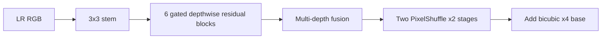

# Model Card: FaithSR v0.1 Base x4

## Purpose and experiment connection

Why: pretrained Swin2SR se independent, lightweight custom control establish karna tha. This is the first custom architecture; DA and observation experiments add one mechanism at a time to this control. The best complex-validation result was epoch 74: 24.6625 dB PSNR and 0.6502 SSIM.

## Function, layers, and activations

With (f_0=C_{3\times3}(x)), six blocks compute

\[
h_i=P_{2,i}(\mathrm{GELU}(D_i(\mathrm{GELU}(P_{1,i}(f_{i-1}))))),\quad
f_i=f_{i-1}+s_i h_i\odot\sigma(G_i(h_i)).
\]

Their outputs are concatenated and fused. Two Conv→PixelShuffle(2) stages give exact x4 residual reconstruction:

\[
\hat y=\mathrm{Bicubic}_4(x)+U_4(F([f_1,\ldots,f_6])+f_0).
\]

| Layer group | Exact design | Reason |
|---|---|---|
| Stem | Conv3x3, 3→48 | Preserve the LR grid while lifting RGB evidence. |
| 6 blocks | Conv1x1 48→96, depthwise Conv3x3, Conv1x1 96→48, channel gate | Cheap spatial/channel mixing; residual scale 0.1 stabilizes early training. |
| Fusion | concat 6×48, Conv1x1→48, GELU, Conv3x3 | Reuse shallow and deep block evidence. |
| Upsampler | twice: Conv3x3 48→192, PixelShuffle(2), GELU; final Conv3x3→3 | Efficient exact x4 sub-pixel reconstruction. |

GELU smoothly retains small negative evidence; sigmoid bounds the channel gate; PixelShuffle is deterministic rearrangement, not an activation.

Parameters: 272,769. Artifacts: [`faithsr_v01_base_x4.zip`](../../../artifacts/training_runs/archives/faithsr_v01_base_x4.zip). Shared loss/degradation details and references: [`model-and-experiment-methodology.md`](../model-and-experiment-methodology.md).
