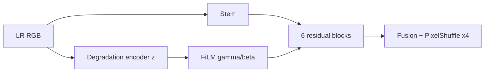

# Model Card: FaithSR v0.1 Degradation-Adaptive x4

## Purpose and experiment connection

Why: Base ko control rakh kar test karna tha ke blind blur/noise/compression estimate aur FiLM conditioning mixed degradation mein help karte hain ya nahi. Best complex-validation result epoch 92 par 24.6759 dB / 0.6520 tha—Base se sirf +0.0134 dB, is liye strong novelty claim supported nahi.

## Function, layers, and activations

The Base forward remains unchanged except an encoder computes

\[
z=\mathrm{GELU}(W_z\mathrm{GAP}(E_c(x))),\quad \hat d=\sigma(W_{d2}\mathrm{GELU}(W_{d1}z)),
\]

and every block uses feature-wise linear modulation:

\[
\bar h_i=(1+\gamma_i(z))\odot h_i+\beta_i(z),\quad
f_i=f_{i-1}+s_i\bar h_i\odot\sigma(G_i(\bar h_i)).
\]

| Added layer group | Exact design | Reason |
|---|---|---|
| Degradation features | Conv3x3/s2: 3→16→32→48, GELU after each, global pool | Enlarges receptive field and accepts arbitrary LR sizes. |
| Embedding/head | Linear 48→64 GELU; 64→32 GELU→3 sigmoid | Compact conditioning plus bounded blur/noise/compression auxiliary targets. |
| FiLM per block | Linear 64→96, split into gamma/beta | Personalizes feature processing to the observed degradation. |

The unchanged backbone is Stem 3→48, six gated depthwise residual blocks, multi-depth fusion, and two PixelShuffle(2) stages. GELU is smooth; sigmoid makes severities/gates interpretable in [0,1].

Parameters: 334,484. Artifacts: [`faithsr_v01_da_x4.zip`](../../../artifacts/training_runs/archives/faithsr_v01_da_x4.zip). Previous: [Base x4](faithsr-v01-base-x4.md). References and losses: [`model-and-experiment-methodology.md`](../model-and-experiment-methodology.md).
