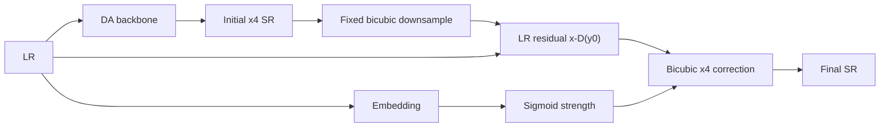

# Model Card: FaithSR v0.1 DA + Observation Consistency x4

## Purpose and experiment connection

Why: degradation-adaptive output ko observed LR measurement ki taraf conservatively pull karke unsupported detail reduce karna test hua. It adds only fixed-bicubic back-projection to DA. Best complex-validation epoch 87 was 24.6082 dB / 0.6471—both Base and DA se lower. This negative result motivated FaithSR-3X's learned positive observation kernel.

## Function, layers, and activations

DA first predicts (hat y_0). A degradation-conditioned MLP computes a bounded strength,

\[
\alpha(z)=\sigma(W_2\mathrm{GELU}(W_1z)),
\]

then fixed bicubic re-observation/back-projection gives

\[
\hat y=\hat y_0+\alpha(z)\mathrm{Bicubic}_4\left(x-\mathrm{BicubicDown}(\hat y_0)\right).
\]

| Layer group | Exact design | Reason |
|---|---|---|
| DA backbone | v0.1 DA encoder, six FiLM/gated blocks, fusion, x4 upsampler | Matched previous model. |
| Consistency gate | Linear 64→16, GELU, Linear 16→1, sigmoid | One interpretable per-image correction strength. |
| Observation operator | fixed bicubic down/up sampling | Simple initial hypothesis; later rejected by the measured regression. |

GELU supports smooth optimization; sigmoid constrains correction strength to [0,1]. The problem was not the activation: a fixed bicubic operator poorly represents unknown blur/compression.

Parameters: 335,541. Artifacts: [`faithsr_v01_full_x4.zip`](../../../artifacts/training_runs/archives/faithsr_v01_full_x4.zip). Previous: [DA x4](faithsr-v01-da-x4.md). References and full lineage: [`model-and-experiment-methodology.md`](../model-and-experiment-methodology.md).
