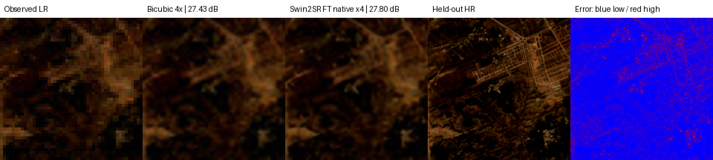
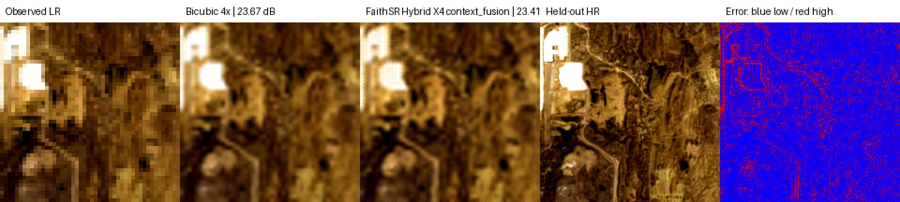

# Fidelity Constrained Satellite Image Super Resolution Through Controlled Ablations of Personalization Consistency Distillation and Context Fusion

**Muhammad Hassan, Muhammad Mahad Khan** 
*[Department and University], [City], Pakistan* 
*Corresponding author: [email address]*

## Abstract

Satellite-image super-resolution must improve spatial detail without inventing structures, changing reflectance, losing geospatial metadata, or violating deployment latency. This study examines a controlled model lineage designed to identify which forms of domain adaptation improve faithful satellite-image reconstruction. The lineage begins with a 272,769-parameter convolutional baseline and tests degradation conditioning, a learned observation operator, spatial uncertainty, generic and personalized Swin2SR teachers, output distillation, compression-aware refinement, parallel context fusion, and a residual consistency cascade. Experiments progress from synthetically degraded UC Merced and EuroSAT imagery to geographically separated Sentinel-2 Level-2A stress tests. The strongest compact hybrid, Parallel Context Fusion, improves the matched medium baseline by 0.03654 dB peak signal-to-noise ratio (PSNR), with a 95% scene-cluster interval of 0.02649–0.04658 dB, and runs end-to-end on a 512 × 512 TIFF block in 423.41 ms on a Tesla P100. However, it improves bicubic interpolation by only 0.07561 dB and 0.02395 structural similarity (SSIM), below the prespecified thresholds of +1.5 dB PSNR and either SSIM ≥ 0.90 or +0.03. By contrast, fully personalized Swin2SR improves native ×4 stress-grid PSNR by 0.50377 dB (95% interval 0.40189–0.60565), SSIM by 0.04228, false-edge rate by 0.01460, spectral angle by 0.01258 rad, and learned perceptual image patch similarity by 0.08691 relative to bicubic. Its full TIFF P95 latency is 3.791 s, within the revised 5 s criterion. A matched ×3 experiment additionally shows that fine-tuning raises Swin2SR from 21.92152 to 23.77746 dB, demonstrating that the result is not explained by generic pretraining alone. Negative findings are equally important: generic teacher distillation changes PSNR by approximately 0.00004 dB; a personalized-teacher compact student gains only 0.00104 dB; and uncertainty–error correlation is negative on native Sentinel-2 data. These results close the lightweight hybrid branch and support a bounded successor: preserve the personalized Swin2SR spatial trunk, add only multispectral radiometric input/output adapters, and evaluate 8/10/12-bit handling, RMSE, registration, spectral fidelity, and metadata preservation on real paired data.

**Index Terms—** satellite image super-resolution, Sentinel-2, Swin2SR, domain personalization, knowledge distillation, multispectral imaging, GeoTIFF, radiometric fidelity, trustworthy artificial intelligence.

## I. Introduction

Single-image super-resolution (SISR) estimates a high-resolution image from one low-resolution observation. The mapping is ill-posed: several high-resolution scenes can produce almost the same low-resolution sample. In consumer imagery, perceptually plausible texture may be acceptable. In Earth observation, an attractive but unsupported roof line, field boundary, or road can corrupt data-driven interpretation. A useful satellite SR system must therefore balance reconstruction quality, spectral and geometric fidelity, computational cost, and provenance.

The study uses a practical operating envelope: accept a TIFF or GeoTIFF image, provide at least threefold spatial upscaling, preserve declared raster metadata, minimize unsupported detail, and process a 512 × 512 block within 5 s. Evaluation includes PSNR, SSIM, root mean squared error (RMSE), registration, and artifact control. An output pixel grid is described as *nominally upsampled*; it is not represented as newly sensed physical ground resolution.

The investigation began with the hypothesis that a compact degradation-aware architecture could combine faithful reconstruction with low latency. That hypothesis produced several useful mechanisms, but controlled results did not justify continuing to add modules. The decisive observation was that the best result came from fully personalizing a published Swin2SR model, whereas frozen Swin2SR and lightweight students were weaker. The research contribution therefore depends on identifying what changed, isolating the effect of personalization, reporting failed mechanisms, and testing a targeted architectural change for satellite data rather than merely renaming a pretrained model.

The contributions of this paper are:

1. a documented experiment chain in which each new mechanism is motivated by a measured deficiency and evaluated by a matched ablation;
2. evidence that high synthetic-degradation scores do not establish native-sensor generalization;
3. evidence that full Sentinel-domain personalization, rather than generic Swin2SR inference alone, provides the strongest completed fidelity result;
4. negative evidence that output-only distillation, unconstrained uncertainty, and progressively larger compact hybrids do not close the fidelity gap;
5. a reproducible TIFF/GeoTIFF inference path with overlap blending, precision checks, compression latency, metadata round trips, and saved qualitative cases; and
6. a defensible branch-closure decision plus a bounded multispectral, radiometrically aware Swin2SR successor.

## II. Literature Review

### A. Efficient Convolutional Super-Resolution

Early deep SISR established that the interpolation stage could be learned jointly with feature extraction. Shi *et al.* introduced sub-pixel convolution, commonly implemented as PixelShuffle, so most computation remains on the low-resolution grid before a deterministic channel-to-space rearrangement [1]. Residual and dense CNNs later increased depth and feature reuse. Efficient Feature Distillation Network (EFDN) demonstrated that compact models can selectively distill useful channels for resource-constrained restoration [2]. These studies motivate the efficient convolution, residual path, dense fusion, and PixelShuffle heads used in FaithSR.

Compactness alone does not guarantee satellite fidelity. A low-parameter network can have insufficient receptive field or capacity for repeated agricultural, river, highway, and urban patterns. It can also optimize average reconstruction while suppressing narrow structures. The present work therefore treats latency and parameter count as constraints, not as substitutes for reconstruction evidence.

### B. Windowed Transformers and Swin2SR

SwinIR divides restoration into shallow feature extraction, deep residual Swin Transformer groups, and high-quality reconstruction [3]. Shifted windows provide local attention at manageable cost while consecutive layers exchange information across window boundaries. Swin2SR extends this family with Swin Transformer V2 components and emphasizes training stability and compressed-image restoration [4]. The inherited Swin2SR used here contains a shallow convolution, six residual SwinV2 groups, six transformer layers per group, 180 feature channels, window size 8, six heads, LayerNorm, scaled cosine attention, GELU multilayer perceptrons, residual convolutions, and a native ×4 PixelShuffle head.

Published Swin results do not imply that an off-the-shelf checkpoint is valid for Sentinel-2. Its original priors, compression assumptions, color distribution, and reconstruction objective differ from surface-reflectance imagery. Our frozen-versus-fine-tuned comparison directly tests this domain gap. It also prevents the misleading conclusion that a pretrained model is strong merely because it is large.

### C. Blind and Real-World Degradation

Synthetic bicubic downsampling is reproducible but represents only one observation process. Real-ESRGAN uses high-order synthetic degradation to approximate blur, resizing, noise, and compression combinations encountered in real imagery [5]. Degradation-aware networks similarly condition restoration on estimated corruption. These studies motivate the blur/noise/compression/aliasing vector and the deterministic seven-profile stress grid used here.

However, a more complex synthetic degradation distribution remains a model of the sensor, not the sensor itself. If training and evaluation use the same simulator, the network can learn its inverse without demonstrating real-domain validity. This distinction explains why the EuroSAT native-×3 experiment is treated as an implementation and convergence check, while Sentinel-2 Level-2A scene-separated tests determine branch decisions.

### D. Sentinel-2 and Multispectral Super-Resolution

Sentinel-2 contains 13 bands sampled at 10, 20, and 60 m ground sampling distances. DSen2 learns to super-resolve lower-resolution Sentinel-2 bands using globally sampled imagery and reports substantial RMSE improvement while preserving spectral characteristics [6]. EuroSAT provides 27,000 labeled Sentinel-2 patches and 13 spectral bands, but its land-cover labels and patch organization do not by themselves create a paired real-SR benchmark [7].

Real paired datasets address this limitation. SEN2VENµS pairs Sentinel-2 surface reflectance with same-day, spatially registered VENµS reference imagery at 5 m and includes eight Sentinel-2 bands across 29 locations [8]. WorldStrat pairs multitemporal 10 m Sentinel-2 observations with SPOT 6/7 imagery up to 1.5 m over geographically diverse sites [9]. Such datasets are preferable for the successor model because they expose cross-sensor registration, radiometry, seasonal mismatch, and real optical transfer effects that same-image downsampling hides.

The literature also establishes an important semantic boundary: upsampling a 10 m Sentinel-2 image to a 2.5 m pixel grid does not make it equivalent to a true 2.5 m acquisition. The target is an estimate constrained by observations and training data. This paper therefore reports numerical fidelity and nominal output scale rather than claiming new sensor measurements.

### E. Trustworthy Evaluation and the Perception–Distortion Tension

Blau and Michaeli formalized a perception–distortion trade-off: improving perceptual realism can conflict with full-reference distortion measures [10]. LPIPS measures deep-feature perceptual similarity [11], whereas PSNR and RMSE emphasize pointwise fidelity and SSIM emphasizes luminance, contrast, and structure [12]. For multispectral imagery, spectral angle mapper (SAM) and ERGAS provide complementary spectral and normalized error views.

OpenSR argues that standard computer-vision metrics on synthetic pairs are insufficient for optical remote-sensing SR and provides spatial, spectral, and hallucination-oriented evaluation on real imagery [13]. This principle directly shapes our protocol: report PSNR, SSIM, RMSE-derived measures, false edges, SAM, ERGAS, LPIPS, re-observation error, deterministic qualitative examples, and scene-cluster confidence intervals. No single score is treated as proof of trustworthy enhancement.

### F. Consistency, Uncertainty, and Distillation

An observation-consistency operator re-degrades the SR estimate and penalizes disagreement with the LR input. In principle, this discourages high-frequency detail that cannot reproduce the observation. FiLM provides feature-wise affine conditioning [14], making it a natural mechanism for applying an estimated degradation vector. Sigmoid-bounded uncertainty can expose risky pixels, but a map is useful only if it correlates positively with realized error.

Knowledge distillation transfers information from a large teacher to a compact student. Hinton *et al.* introduced the general teacher–student framework [15], and Zhang *et al.* studied SR-specific data-free distillation [16]. Success depends on teacher quality, student capacity, data alignment, and the transferred representation. Output imitation from a generic teacher can propagate domain mismatch; even a personalized teacher may provide little benefit if the student loss already matches the same target. Our two distillation studies test both cases rather than assuming transfer must work.

### G. Research Gap

Prior work supports powerful transformers, lightweight CNNs, degradation simulation, real paired satellite datasets, and multi-metric evaluation. The unresolved gap is how these choices behave under one controlled progression from synthetic degradation to geographically separated native Sentinel imagery while preserving deployment constraints. Four questions follow: which mechanism helps under identical data; whether synthetic gains transfer to native Sentinel imagery; whether pretrained strength survives domain mismatch; and whether the quality gain remains compatible with TIFF latency and metadata. The experiments answer these questions and use the evidence to constrain the next architecture.

## III. Requirements, Data, and Evaluation Protocol

### A. Prespecified Evaluation Criteria

The prespecified criteria are: output scale at least ×3; 8-, 10-, and 12-bit radiometric input support; multispectral compatibility; PSNR improvement of at least 1.5 dB; SSIM at least 0.90 or improvement of at least 0.03; RMSE reduction of at least 10%; registration error at most 0.5 pixel; complete preservation of required metadata; artifact control; and 512 × 512 processing within 5 s. At least six of seven quantitative criteria must pass for model acceptance. Historical experiments that predate some criteria are marked incomplete rather than retroactively classified as compliant.

### B. Data Progression

The experimental progression is deliberate:

- **UC Merced:** historical RGB control for the first custom ×4 model.
- **EuroSAT RGB:** 27,000 Sentinel-2-derived land-cover patches used for a native-×3 convergence check under known synthetic degradation.
- **Sentinel Delhi:** geographically split synthetic-pair ablation used to isolate model components.
- **Native Sentinel-2 Level-2A stress set:** 86 tiles from six scenes, with 39 training and 47 validation tiles and three held-out scene clusters. Seven deterministic degradation profiles produce 329 paired stress cases.
- **Future paired data:** SEN2VENµS or WorldStrat for real cross-sensor reference evaluation; this is not claimed as completed in this paper.

Geographic groups, not random patches, define confidence resampling units. This reduces leakage from neighboring crops and prevents the nominal number of overlapping patches from exaggerating certainty.

### C. Observation Model

For a normalized high-resolution target **y**, the controlled LR observation is

$$
\mathbf{x}=Q_8\!\left(J_q\!\left(N_{g,p}\!\left(\downarrow_s(\mathbf{k}*\mathbf{y})\right)\right)\right),
$$

where **k** is a blur kernel, ↓ₛ is scale-*s* decimation, (N_{g,p}) combines Gaussian and optional Poisson noise, (J_q) applies JPEG quality *q*, and (Q_8) is the historical 8-bit quantizer. The degradation vector records blur, noise, compression, and aliasing controls. The successor replaces the fixed (Q_8) assumption with a bit-depth-aware digital-number codec.

### D. Metrics and Statistical Reporting

For *N* target values (y_i) and predictions (hat y_i),

$$
\operatorname{RMSE}=\sqrt{\frac{1}{N}\sum_{i=1}^{N}(\hat y_i-y_i)^2},
\qquad
\operatorname{PSNR}=20\log_{10}\!\left(\frac{L}{\operatorname{RMSE}}\right),
$$

where *L* is the declared data range. SSIM follows Wang *et al.* [12]. Spectral angle is

$$
\operatorname{SAM}(\hat{\mathbf{s}},\mathbf{s})=
\arccos\!\left(
\frac{\hat{\mathbf{s}}^\mathsf{T}\mathbf{s}}
{\lVert\hat{\mathbf{s}}\rVert_2\lVert\mathbf{s}\rVert_2+\varepsilon}
\right).
$$

False-edge rate compares unsupported gradients, LPIPS measures perceptual feature distance, and re-observation L1 measures whether a reconstructed output maps back to the LR evidence. Differences use paired scene-cluster bootstrap intervals. A confidence interval that excludes zero supports a consistent effect on the sampled scenes; it does not establish operational sufficiency.

## IV. Model Family and Mathematical Formulation

### A. FaithSR v0.1

The first custom model tests whether compact residual CNNs can support explicit degradation adaptation. A 3 × 3 stem produces 48 channels. Each of six efficient blocks expands channels with a 1 × 1 convolution, applies GELU, a 3 × 3 depthwise convolution, another GELU, and a 1 × 1 projection. In the conditioned variant, FiLM parameters scale and shift the residual:

$$
\mathbf{r}_i=C^{(i)}_{1\times1,\downarrow}
\!\left(\operatorname{GELU}\!\left(
C^{(i)}_{3\times3,\mathrm{dw}}
\!\left(\operatorname{GELU}\!\left(C^{(i)}_{1\times1,\uparrow}(\mathbf{f}_{i-1})\right)\right)
\right)\right),
$$

$$
\mathbf{f}_i=\mathbf{f}_{i-1}+\gamma_i(\mathbf{z})\odot\mathbf{r}_i+\beta_i(\mathbf{z}).
$$

The six outputs are concatenated, reduced by 1 × 1 convolution, refined by GELU and 3 × 3 convolution, and reconstructed through ×2 or ×4 PixelShuffle over a bicubic residual base. The Full variant adds a fixed bicubic re-observation correction with a sigmoid-bounded gate.

### B. FaithSR-3X

FaithSR-3X maps an RGB batch of shape **B × 3 × H × W** to **B × 3 × 3H × 3W**. Its degradation encoder is Conv3×3/stride2 3→24, GELU, Conv 24→40, GELU, Conv 40→56, GELU, global average pooling, and Linear 56→48. An auxiliary Linear 48→32→4 sigmoid head estimates normalized degradation controls.

The reconstruction stem is Conv3×3 3→32. Six adaptive blocks use 1×1 expansion 32→64, GELU, depthwise Conv3×3, GELU, and 1×1 projection 64→32. FiLM is generated from the 48-dimensional embedding; a squeeze gate 32→8→32 uses sigmoid; and residual scales begin at 0.1. Dense fusion concatenates 6×32 channels, applies Conv1×1 192→32, GELU, Conv3×3 32→32, and adds the stem feature.

The initial SR estimate is

$$
\hat{\mathbf{y}}_0=\operatorname{Bicubic}_3(\mathbf{x})+
\operatorname{PixelShuffle}_3\!\left(C_r(\mathbf{f})\right),
$$

where (C_r) predicts 27 channels because (3\times3^2=27). The learned observation kernel and bounded correction are

$$
\mathbf{k}_{\mathbf{z}}=\operatorname{softmax}(W_k\mathbf{z}),
\quad \sum_{p,q}k_{\mathbf{z}}[p,q]=1,
\quad k_{\mathbf{z}}[p,q]\ge 0,
$$

$$
\alpha(\mathbf{z})=0.25\,\sigma\!\left(W_{a2}\operatorname{GELU}(W_{a1}\mathbf{z})\right).
$$

The uncertainty head is Conv3×3 32→16, GELU, Conv3×3 16→1, sigmoid, then bilinear ×3 resize. It predicts a bounded map **u** in [0,1]. A valid uncertainty model should show a positive correlation between **u** and realized reconstruction error.

### C. Personalized Swin2SR

The pinned Swin2SR ×4 model has 12,239,283 trainable parameters. For a window feature (X\), scaled cosine attention is summarized as

$$
\operatorname{Attention}(Q,K,V)=
\operatorname{softmax}\!\left(
\frac{\cos(Q,K)}{\tau}+S
\right)V,
$$

where τ is a learnable temperature and *S* contains relative position bias. Window shifts allow information exchange across adjacent windows. LayerNorm precedes attention and the GELU MLP. Six residual SwinV2 groups are enclosed by convolutional residual paths, followed by the native ×4 PixelShuffle reconstruction head.

The model is first evaluated with frozen generic weights and then fully fine-tuned with Smooth-L1 loss:

$$
\mathcal{L}_{\mathrm{Swin}}=
\frac{1}{N}\sum_i
\operatorname{SmoothL1}\!\left(T_{\theta,4}(\mathbf{x})_i-\mathbf{y}_{4,i}\right).
$$

For the matched ×3 comparison only, the ×4 output is antialiased-resized to 3H × 3W. The product diagnostic retains the native ×4 output because the requirement is at least ×3.

### D. Loss for Custom Models

The most complete custom objective is

$$
\mathcal{L}=\mathcal{L}_{\mathrm{Char}}+0.10\mathcal{L}_{\mathrm{SSIM}}
+0.03\mathcal{L}_{\nabla}+0.02\mathcal{L}_{\mathrm{freq}}
+0.05\mathcal{L}_{\mathrm{obs}}+0.02\mathcal{L}_{\mathrm{deg}}
+0.02\mathcal{L}_{\mathrm{uq}}+\lambda_{\mathrm{KD}}\mathcal{L}_{\mathrm{KD}}.
$$

Charbonnier loss is

$$
\mathcal{L}_{\mathrm{Char}}=
\frac{1}{N}\sum_i\sqrt{(\hat y_i-y_i)^2+\epsilon^2}.
$$

The terms penalize structural dissimilarity, gradient error, Fourier-magnitude error, LR re-observation error, degradation-vector error, and uncertainty calibration. Distillation uses λₖᴅ = 0.05 only in registered teacher variants. The weights are fixed within each matched comparison; no result is attributed to architecture when the objective changes.

### E. FaithSR-Lite-X4 and the Two Hybrid Approaches

FaithSR-Lite-X4 uses 32 channels, six adaptive blocks with 7 × 7 depthwise convolution, dense fusion, and Conv3×3 32→48 followed by PixelShuffle(4). Optional degradation/compression refinement uses a positive normalized 7 × 7 observation kernel and a bounded consistency gate.

The later capacity-matched base uses 48 channels and eight efficient residual blocks:

$$
\mathbf{F}_i=\mathbf{F}_{i-1}+s_i C_{1\times1}
\!\left(DW_{3\times3}\!\left(
\operatorname{GELU}\!\left(C_{1\times1}\!\left(
\operatorname{GELU}\!\left(DW_{3\times3}(\mathbf{F}_{i-1})\right)
\right)\right)\right)\right).
$$

Parallel Context Fusion builds full-, half-, and quarter-resolution depthwise 7 × 7 context, resizes the low-resolution branches, and uses a learned gate:

$$
\mathbf{G}=\sigma\!\left(C_{1\times1}\!\left(
\operatorname{GELU}\!\left(C_{1\times1}[\mathbf{F},\mathbf{C}]\right)
\right)\right),
\qquad
\mathbf{F}'=\mathbf{F}+\mathbf{G}\odot\mathbf{C}.
$$

The Residual Consistency Cascade first predicts Ŷ₀, re-observes it by area downsampling, computes (\mathbf{E}=\mathbf{x}-\downarrow_4(\hat{\mathbf{Y}}_0)), and passes **E** through a three-block expert. Its correction is limited by (0.15\sigma(g)). Both approaches were evaluated separately against the same medium base; they were not stacked.

### F. Activations and Normalization

All nonlinearities used across the experiment lineage are listed here.

The Gaussian Error Linear Unit is

$$
\operatorname{GELU}(a)=a\Phi(a)\approx
\frac{a}{2}\left[1+\tanh\!\left(
\sqrt{\frac{2}{\pi}}(a+0.044715a^3)
\right)\right].
$$

It preserves small negative evidence and supplies smooth gradients in both compact residual blocks and the pretrained transformer MLPs. Changing it inside Swin2SR would invalidate reuse of learned weights.

The sigmoid is

$$
\sigma(a)=\frac{1}{1+e^{-a}},
$$

and bounds gates, degradation estimates, and uncertainty. Softmax is

$$
\operatorname{softmax}(a_i)=\frac{e^{a_i}}{\sum_j e^{a_j}},
$$

and normalizes attention weights and positive observation kernels. LayerNorm stabilizes transformer features across channels. PixelShuffle is not an activation: it deterministically rearranges **C·r² × H × W** features into **C × rH × rW**.

### G. Tiled GeoTIFF Inference

Overlapping tile predictions are merged with a two-dimensional Hann weight (w_i(p)):

$$
\hat{\mathbf{y}}(p)=
\frac{\sum_i w_i(p)\hat{\mathbf{y}}_i(p)}
{\max\!\left(\sum_i w_i(p),\varepsilon\right)}.
$$

Disk-backed accumulation prevents whole-scene memory growth. Output width, height, affine transform, coordinate reference system, nodata declaration, band descriptions, and non-conflicting tags are propagated or scaled as appropriate. Compression and model latency are measured separately and together.

## V. Experiment Logic and Results

### A. Experiment 1: Custom v0.1 Baseline and Degradation Adaptation

**Why it was run.** A custom baseline was needed to test whether explicit degradation information could add value beyond a standard lightweight residual CNN while keeping model capacity and conditioning mechanisms directly observable.

**Hypothesis.** FiLM conditioning from an estimated degradation embedding would improve difficult blur/noise/compression cases, while observation correction would reduce unsupported detail.

**Result.** Base ×4 reached 24.6625 dB PSNR and 0.6502 SSIM with 272,769 parameters. Degradation Adaptation reached 24.6759 dB and 0.6520 SSIM with 334,484 parameters, a gain of 0.0134 dB. The Full fixed-observation variant fell to 24.6082 dB and 0.6471 SSIM.

**What it proved and how it connected.** Conditioning had a positive but practically small effect. Fixed bicubic re-observation could over-correct when the actual degradation differed. This justified a native ×3 model with a richer degradation target and a learned positive observation kernel, but did not justify claiming a successful final model.

### B. Experiment 2: EuroSAT Native ×3 Convergence

**Why it was run.** Before expensive geographic experiments, the new ×3 implementation, loss, PixelShuffle channel count, checkpointing, and evaluation path had to be verified.

**Hypothesis.** FaithSR-3X should learn the inverse of the registered synthetic observation model and outperform bicubic on held-out synthetic pairs.

**Result.** The best validation result was 30.6966 dB PSNR and 0.84078 SSIM. On a matched 6,000-image evaluation, FaithSR reached 30.6825 dB versus 22.7390 dB for bicubic.

**What it proved and how it connected.** The architecture converged and the code path was correct. It did **not** prove native Sentinel-2 enhancement because both LR and HR were derived from the same patches by a known simulator. This large synthetic gain made a geographically separated Sentinel experiment necessary rather than sufficient.

### C. Experiment 3: Delhi Component Ablation

**Why it was run.** The EuroSAT result could not attribute gains to degradation conditioning, observation consistency, or uncertainty. Geographic grouping was added to reduce leakage.

**Hypothesis.** Each mechanism should improve the same held-out scenes relative to the immediately preceding variant.

**Result.** Plain FaithSR reached 24.1724 dB. Degradation Adaptation reached 24.1976 dB: +0.02594 dB with a 95% interval of +0.02112 to +0.03076. The observation variant reached 24.1897 dB, 0.00826 dB below Degradation Adaptation, although SSIM rose by 0.00078. Full reached 24.1911 dB. Bicubic was 22.3652 dB; Full exceeded it by 1.84378 dB with a 95% interval of 1.69044–1.99712. Uncertainty–error correlation was only 0.19524.

**What it proved and how it connected.** The small conditioning gain was statistically consistent, but learned observation correction was mixed rather than uniformly beneficial. The large bicubic gain still belonged to a synthetic/display-style product. Uncertainty correlation was too weak for a safety claim. The next experiment tested whether a strong pretrained teacher could improve the compact student.

### D. Experiment 4: Generic Swin2SR Distillation

**Why it was run.** Distillation offered a possible way to retain compact inference while importing a transformer's learned image prior.

**Hypothesis.** A frozen generic Swin2SR ×4 teacher, resized to ×3, would provide a useful soft target for FaithSR-3X.

**Result.** The distilled student reached 24.19109 dB versus 24.19106 dB for the matched non-distilled Full student, a change of approximately +0.00004 dB. The generic teacher itself reached 19.67141 dB after ×4-to-×3 resizing, below the 22.36519 dB bicubic baseline.

**What it proved and how it connected.** A teacher's published reputation is irrelevant when its domain and scale are mismatched. Output imitation could not add information beyond the supervised target and risked transferring the wrong prior. This negative result led to direct full-domain fine-tuning of the teacher before any further student experiment.

### E. Experiment 5: Native Sentinel-2 FaithSR Validation

**Why it was run.** Synthetic pairs could hide the domain gap. The custom family needed to be tested on frozen native Sentinel-2 Level-2A tiles with scene-cluster evaluation.

**Hypothesis.** The Plain model should exceed bicubic, and the Full model should add observation fidelity and meaningful uncertainty.

**Result.** Bicubic reached 23.41633 dB PSNR, 0.59057 SSIM, 0.13229 false-edge rate, 0.40417 SAM, 28.04499 ERGAS, and 0.62166 LPIPS. Plain reached 23.13413 dB and 0.59140 SSIM. Full reached 23.05308 dB, 0.58783 SSIM, 0.13795 false-edge rate, 0.42096 SAM, 29.37433 ERGAS, and 0.54940 LPIPS. Plain was 0.26044 dB below bicubic (95% interval −0.33753 to −0.18336); Full was 0.33530 dB below bicubic (−0.43653 to −0.23407). Full uncertainty correlation was −0.26663.

**What it proved and how it connected.** The custom model improved perceptual distance but worsened distortion, edges, spectral angle, and ERGAS. The negative uncertainty correlation means higher predicted risk did not identify higher realized error. This result falsified the assumption that synthetic gains transfer automatically and made direct Swin2SR personalization the appropriate control.

### F. Experiment 6: Full Swin2SR Personalization

**Why it was run.** The generic teacher had failed, but that did not distinguish architectural inadequacy from domain mismatch. Frozen and fully fine-tuned states of the same checkpoint were compared under the same data.

**Hypothesis.** If domain mismatch is the main problem, full fine-tuning should substantially improve the frozen model and exceed bicubic without changing architecture.

**Matched ×3 result.** Frozen Swin2SR reached 21.92152 dB PSNR and 0.54311 SSIM. Fully fine-tuned Swin2SR reached 23.77746 dB and 0.61740 SSIM, compared with 23.41633 dB and 0.59057 for bicubic. The fine-tuned model improved PSNR over the frozen state by 1.85594 dB. Relative to bicubic, the paired mean PSNR gain was 0.33646 dB with a 95% interval of 0.04417–0.62876; SSIM improved by 0.02883, false-edge rate by 0.00821, SAM by 0.02050 rad, and LPIPS by 0.07080.

**Native ×4 result.** Across 329 stress cases, personalized Swin2SR improved PSNR by 0.50377 dB (95% interval 0.40189–0.60565), SSIM by 0.04228, false-edge rate by 0.01460, SAM by 0.01258 rad, ERGAS by 0.92793, LPIPS by 0.08691, and re-observation L1 by 0.00291 relative to bicubic. The compression-heavy PSNR gain was only 0.0193 dB and its interval crossed zero, identifying the remaining stress weakness.

**Why the pretrained model became better.** The controlled evidence supports three statements. First, generic pretraining alone was insufficient: frozen Swin2SR was below bicubic and 1.85594 dB below its fine-tuned state in the matched ×3 comparison. Second, full fine-tuning aligned the entire 12.2-million-parameter hierarchy—not only the last layer—to Sentinel-derived spatial statistics and the registered degradation distribution. Third, the deep shifted-window hierarchy and larger feature capacity plausibly preserve repeated and nonlocal structures that the approximately 0.1-million-parameter CNNs compress or smooth. The literature supports this mechanism through SwinIR/Swin2SR's local attention, window shifting, residual groups, and stable SwinV2 training [3], [4]. The experiment does **not** isolate attention from capacity, depth, pretraining data, or optimization; therefore it cannot claim that attention alone caused the advantage.

**Deployment result.** Native ×4 FP32 P95 latency was 3.419 s model-only and 3.791 s through the TIFF path. These values exceeded the initial 1 s target but satisfy the revised 5 s runtime criterion. The revised limit removes the main reason to prefer a much weaker compact model.

**Fig. 1.** Deterministically selected median native-×4 Swin2SR stress case. The saved panel contains LR, bicubic, personalized model, target, and error evidence; visual sharpness is interpreted together with numerical fidelity.

### G. Experiment 7: Personalized-Teacher FaithSR-Lite-X4

**Why it was run.** Under the earlier 1 s target, the personalized teacher was too slow. A new native-×4 student tested whether teacher transfer and compression-aware refinement could preserve quality at sub-second latency.

**Hypothesis.** A domain-matched teacher should be more useful than the rejected generic teacher, and a compression branch should improve the identified compression-heavy weakness.

**Result.** Base reached 23.68809 dB; Distilled 23.68923 dB; Compression 23.64276 dB; and Full 23.64512 dB. Distillation improved Base by only 0.00104 dB while worsening LPIPS by 0.00128. Compression reduced PSNR by 0.04286 dB but improved LPIPS by 0.01565 and worsened observation L1. Full was 0.04427 dB below bicubic. Full P95 latency was approximately 73 ms model-only and 482.85 ms end-to-end FP32, or 399.19 ms FP16.

**What it proved and how it connected.** Personalizing the teacher removed one source of mismatch but did not overcome the student's capacity/objective limit. Compression refinement exposed a perception–distortion trade-off rather than a full-fidelity gain. The branch retained the student as a latency floor and tested two targeted hybrids between this floor and the Swin2SR quality ceiling.

### H. Experiment 8: Parallel Context Fusion and Residual Cascade

**Why it was run.** The Lite model was fast but soft. Two measured possibilities remained: insufficient multi-scale context or insufficient LR consistency after the first reconstruction.

**Hypotheses.** Parallel context should recover wider spatial structure without transformer cost. A residual cascade should correct only the part of the LR observation not reproduced by the first estimate.

**Result.** The common Medium Base (106,712 parameters) reached 23.73499 dB and 0.62680 SSIM. Context Fusion (155,720 parameters) reached 23.77394 dB and 0.62945; its paired gain over Medium Base was 0.03654 dB (95% interval 0.02649–0.04658), with SSIM +0.002617, false-edge −0.000744, LPIPS −0.003809, and observation L1 −0.000398. Residual Cascade (147,732 parameters) improved Base by 0.01697 dB (0.01208–0.02185). Context Fusion exceeded bicubic by only 0.07561 dB and SSIM by 0.02395. FP16 P95 latency was 48.44 ms model-only and 423.41 ms TIFF for Context Fusion.

**Fig. 2.** Deterministically selected worst Context Fusion stress case. Retaining the failure case prevents qualitative cherry-picking.

**What it proved and why the branch closed.** Both hypotheses produced small, statistically consistent improvements, with Context Fusion stronger. Nevertheless, the accepted hybrid missed the prespecified PSNR and SSIM thresholds and remained far below personalized Swin2SR. Under the revised 5 s criterion, its large speed advantage no longer compensates for this fidelity gap. Adding more blocks would become architecture search without a bounded hypothesis. The lightweight custom and hybrid branch is therefore closed.

### I. Experiment 9: Deployment, Precision, and Downstream Checks

**Why it was run.** A research score does not guarantee a deployable TIFF application or useful analytical output.

**Result.** Deflate, LZW, and uncompressed TIFF P95 write-path measurements were 743.43, 697.34, and 460.42 ms in the recorded experiment. ONNX export preserved exact ×3 dimensions and differed from the PyTorch reference by at most (1.04\times10^{-5}) in normalized floating output. FP16 and FP32 final uint8 products differed by at most one digital number. A frozen 53,335-parameter land-cover probe used three stride-2 Conv3×3 layers (3→24→48→96), GELU, global average pooling, and a linear classifier. FaithSR input achieved 0.66512 accuracy and 0.24084 macro-F1 versus 0.65238 and 0.23543 for bicubic, an accuracy gain of 1.54 percentage points (95% interval 0.66–2.42). Class imbalance and the weak probe prevent a broad semantic claim.

**What it proved.** The engineering path is reproducible and precision conversion is bounded. The downstream result is supportive but not a substitute for radiometric, spectral, and geometric validation.

## VI. Consolidated Discussion

### A. What the Complete Experiment Chain Establishes

Table I condenses the decision evidence.

| Stage | Main comparison | Measured outcome | Research decision |
|---|---|---:|---|
| v0.1 DA | DA vs Base | +0.0134 dB | Keep as weak conditioning evidence |
| v0.1 Full | Fixed consistency vs Base | −0.0543 dB | Reject fixed operator |
| EuroSAT ×3 | FaithSR vs bicubic | +7.9435 dB | Verify convergence only |
| Delhi DA | DA vs Plain | +0.02594 dB, CI excludes 0 | Effect is consistent but small |
| Delhi observation | Observation vs DA | −0.00826 dB | Mixed contribution |
| Generic distillation | Student KD vs non-KD | ≈ +0.00004 dB | Reject generic teacher transfer |
| Native FaithSR Full | Full vs bicubic | −0.33530 dB | Reject native fidelity claim |
| Swin2SR ×3 | Fine-tuned vs frozen | +1.85594 dB | Domain personalization is decisive |
| Swin2SR native ×4 | Fine-tuned vs bicubic | +0.50377 dB, CI 0.40189–0.60565 | Strongest completed model |
| Lite personalized KD | Distilled vs Base | +0.00104 dB | No material distillation gain |
| Context Fusion | Context vs Medium Base | +0.03654 dB, CI 0.02649–0.04658 | Best compact hybrid, still insufficient |

Three conclusions follow. First, synthetic-pair success is necessary for debugging but insufficient for real-product evidence. Second, component gains of a few hundredths of a decibel can be statistically stable yet operationally irrelevant. Third, pretrained architecture and domain personalization are separate variables: generic Swin2SR failed, whereas fully fine-tuned Swin2SR became the strongest model.

### B. Why Swin2SR Outperformed the Custom Models

The observed advantage is consistent with four interacting factors:

1. **Capacity:** 12.24 million parameters versus approximately 0.1–0.34 million allow richer conditional reconstruction.
2. **Receptive field:** shifted-window layers and stacked residual groups aggregate repeated structure beyond a shallow CNN's effective context.
3. **Transferable initialization:** natural-image restoration pretraining supplies useful edges and textures, but the frozen failure proves it must be adapted.
4. **Full-domain optimization:** updating all layers aligns early filters, attention, normalization, and reconstruction with Sentinel-derived degradation and image statistics.

Only the effect of full fine-tuning versus freezing is isolated by the present experiment. Capacity, attention, and pretraining are jointly confounded, so they are plausible explanations supported by architecture literature, not individually proven causes.

### C. Why Distillation Did Not Close the Gap

The generic teacher was itself worse than bicubic under the target protocol, so its soft output was unsuitable. The personalized teacher was strong, but the compact student remained constrained by capacity and trained against the same ground-truth target; output-only Smooth-L1 imitation added little new information. Feature-level or relational distillation remains possible future work, but current evidence does not justify more complexity when the teacher already meets latency.

### D. Fidelity Versus Perception

Several models improved LPIPS while worsening PSNR, SAM, or false-edge rate. This is an empirical instance of the perception–distortion tension [10]. For operational satellite use, perceptual gains cannot overrule radiometric or structural failures. The paper therefore avoids a “sharper is better” conclusion and treats hallucination control as a measured property.

### E. Status Against the Prespecified Acceptance Criteria

Personalized Swin2SR passes the scale, SSIM improvement, latency, and several artifact criteria in the completed RGB experiment. It does not yet establish the required +1.5 dB PSNR, 10% RMSE reduction, 10/12-bit support, multispectral operation, ≤0.5-pixel registration, or full real-pair validation. Context Fusion passes latency and engineering checks but misses the PSNR and SSIM criteria. Neither branch therefore satisfies the complete acceptance protocol.

## VII. Successor Architecture: Multispectral Radiometric Swin2SR

The next model changes only the parts unsupported by the RGB pretrained interface. The working name **MSR-Swin2SR** denotes multispectral and radiometric adaptation; it is not a novelty claim until ablations and literature comparison support it.

### A. Spectral Input Adapter

For **B** samples, **C** declared bands, height **H**, and width **W**,

$$
\mathbf{x}\in[0,1]^{B\times C\times H\times W}.
$$

A depthwise 3 × 3 convolution learns within-band spatial preprocessing and a 1 × 1 projection maps the bands to the pretrained 180-channel trunk:

$$
\mathbf{b}=DWConv_{3\times3}(\mathbf{x}),
\qquad
\mathbf{f}_0=Conv_{1\times1}^{C\rightarrow180}(\mathbf{b}).
$$

A bounded spectral channel gate is

$$
\mathbf{a}=\sigma\!\left(W_2\operatorname{GELU}(W_1\operatorname{GAP}(\mathbf{f}_0))\right),
\qquad
\mathbf{f}_{\mathrm{in}}=\mathbf{f}_0+\mathbf{a}\odot\mathbf{f}_0.
$$

The first registered profile uses B2, B3, B4, and B8 on the shared 10 m grid. Mixing 10, 20, and 60 m bands is prohibited until an explicit alignment and point-spread-function policy is validated.

### B. Retained Spatial Trunk and Band-Aware Head

The personalized Swin2SR trunk remains unchanged in the first ablation. A new reconstruction convolution predicts (16C) channels and PixelShuffle(4) returns **C** bands:

$$
\hat{\mathbf{y}}=\operatorname{clip}\!\left(
\operatorname{Bicubic}_4(\mathbf{x})+
\operatorname{PixelShuffle}_4\!\left(Conv_{3\times3}^{180\rightarrow16C}(\mathbf{f})\right),0,1
\right).
$$

This design reuses the strongest spatial representation while making the smallest necessary input/output change. It is tested in three variants only: RGB personalized control, multispectral adapters with frozen trunk, and multispectral adapters with full trunk fine-tuning.

### C. Bit-Depth and Radiometric Codec

For unsigned *b*-bit digital numbers,

$$
x_{\mathrm{norm}}=\frac{x_{\mathrm{DN}}}{2^b-1},
\qquad
\hat x_{\mathrm{DN}}=
\operatorname{round}\!\left(\operatorname{clip}(\hat x_{\mathrm{norm}},0,1)(2^b-1)\right).
$$

Source dtype, declared bit depth, scale/offset, nodata, and band descriptions must be preserved. This codec is tested independently for 8, 10, and 12 bits so a successful 8-bit RGB run cannot stand in for higher-radiometric precision.

### D. Fidelity Objective and Registration

The bounded successor objective is

$$
\mathcal{L}_{\mathrm{MSR}}=
\mathcal{L}_{\mathrm{Char}}+
\lambda_s\mathcal{L}_{\mathrm{SSIM}}+
\lambda_r\mathcal{L}_{\mathrm{RMSE}}+
\lambda_{\mathrm{sam}}\mathcal{L}_{\mathrm{SAM}}+
\lambda_g\mathcal{L}_{\nabla}+
\lambda_o\mathcal{L}_{\mathrm{obs}}.
$$

No adversarial loss is included because the product prioritizes evidence fidelity over plausible texture. Cross-sensor pairs are aligned before training. Residual translation is measured by phase correlation or a registered control-point method and must be at most 0.5 output pixel. Registration statistics are reported before and after SR; a network is not credited for errors introduced by the pairing pipeline.

### E. Stop Rules

The successor is accepted only if it improves the personalized RGB Swin2SR control on predefined spectral and radiometric metrics, satisfies the 5 s TIFF latency, preserves metadata, and does not worsen false edges or registration. If the spectral adapter fails, personalized RGB Swin2SR remains the reference and multispectral adaptation is reported as a negative ablation. Mamba, generative adversarial loss, diffusion, or another cascade is excluded unless a measured failure specifically selects it.

## VIII. Limitations and Threats to Validity

The native experiment contains 86 tiles and six scenes; scene-cluster intervals are more honest than patch-level intervals but still cover limited geography. Most training targets are derived by synthetic degradation rather than independent higher-resolution acquisitions. The completed models are RGB and 8-bit; multispectral, 10/12-bit, RMSE-gate, and registration-gate claims remain untested. The downstream classifier is small and class-imbalanced. Latency is hardware- and software-specific and must be remeasured in the final application. The revised 5 s requirement changes the deployment decision but does not retroactively improve model fidelity. Finally, full fine-tuning versus freezing isolates personalization but does not independently isolate attention, parameter count, dataset scale, or optimizer effects.

## IX. Future Work

The immediate priority is evaluation with real paired observations. SEN2VENµS provides same-day Sentinel-2 and VENµS surface-reflectance pairs, while WorldStrat provides temporally matched Sentinel-2 and SPOT imagery across diverse locations. These datasets can test whether the gains observed under controlled degradation persist when the reference comes from an independent sensor. Their use will require explicit handling of point-spread functions, acquisition-time differences, atmospheric effects, and residual geometric error. Registration should be measured before training and reported with the reconstruction metrics so that alignment error is not mistaken for model error.

The proposed MSR-Swin2SR architecture should be evaluated through three matched variants: the personalized RGB control, multispectral input and output adapters with a frozen spatial trunk, and the same adapters with full trunk fine-tuning. The first multispectral profile should use Sentinel-2 B2, B3, B4, and B8 bands on their shared 10 m grid. Extending the model to 20 m and 60 m bands should follow only after a validated resampling and alignment policy is available. Separate 8-bit, 10-bit, and 12-bit tests should measure digital-number error, reflectance RMSE, spectral angle, clipping frequency, and metadata round trips rather than treating a uint16 container as proof of radiometric support.

Uncertainty estimation also requires a new calibration study. The negative uncertainty-error correlation in the native experiment shows that the current sigmoid risk head is not reliable. Future work should compare error-conditioned targets, calibration curves, expected calibration error, and selective prediction in which uncertain regions are withheld from automated interpretation. Downstream evaluation should move beyond the small land-cover probe to geographically separated segmentation or change-detection tasks with class-balanced reporting.

Efficiency research should remain tied to a measured deployment constraint. Since personalized Swin2SR already meets the current 5 s criterion, pruning, feature-level distillation, quantization, Mamba blocks, or additional cascades should be considered only if the multispectral model violates latency or memory limits. Final validation should use untouched geographic sites, report scene-level confidence intervals, retain deterministic failure cases, and compare against both interpolation and current satellite-SR baselines.

## X. Conclusion

The central research gap was whether a compact, fidelity-constrained hybrid could combine low latency with reliable transfer from synthetic degradation to native Sentinel imagery. The custom FaithSR lineage produced interpretable ablations, sub-second inference, and small component gains, but its best hybrid did not meet the required fidelity improvement. Fully personalized Swin2SR was stronger across distortion, structure, spectral angle, false edges, and perceptual distance, and it satisfies the revised 5 s latency criterion. The frozen checkpoint's poor result and the 1.85594 dB gain after full fine-tuning show that domain personalization, rather than generic pretrained inference, produced the stronger reconstruction. The lightweight hybrid approach is therefore closed. The next bounded contribution is a multispectral, radiometrically aware adapter around the validated Swin2SR trunk, evaluated on real paired Sentinel data with 8/10/12-bit, RMSE, registration, spectral, artifact, metadata, and latency criteria.

## Appendix A. Layer Inventory

| Model | Layer sequence | Parameters / output |
|---|---|---|
| FaithSR v0.1 Base | Conv3×3 stem; 6 × [Conv1×1, GELU, DWConv3×3, GELU, Conv1×1]; dense fusion; PixelShuffle | 272,769; ×4 control |
| v0.1 DA | Base + 3 strided Conv degradation encoder + GAP + Linear + FiLM | 334,484; ×4 |
| v0.1 Full | DA + fixed bicubic observation correction + GELU/sigmoid gate | 335,541; ×4 |
| FaithSR-3X | degradation encoder 3→24→40→56; 48-D embedding; stem 3→32; 6 adaptive 32→64→32 blocks; fusion 192→32; Conv 32→27; PixelShuffle3 | 117,224 class; ×3 |
| FaithSR UQ | Conv3×3 32→16, GELU, Conv3×3 16→1, sigmoid, bilinear3 | one-channel risk map |
| Swin2SR | Conv3×3; 6 residual SwinV2 groups × 6 layers; 180 channels; 6 heads; window 8; LayerNorm; scaled cosine attention; GELU MLP; Conv residual paths; PixelShuffle4 | 12,239,283; ×4 |
| FaithSR-Lite-X4 | stem 3→32; 6 adaptive 7×7-DW blocks; fusion; Conv 32→48; PixelShuffle4; optional degradation/observation refiner | Base through Full ablations |
| Medium Base | 48-channel stem; 8 efficient residual blocks; dense fusion; Conv to 48 channels; PixelShuffle4 | 106,712; ×4 |
| Context Fusion | Medium Base + full/half/quarter 7×7-DW context + GELU/sigmoid fusion | 155,720; ×4 |
| Residual Cascade | Medium Base + area re-observation + 3-block error expert + 0.15-sigmoid correction | 147,732; ×4 |
| Land-cover probe | Conv3×3/s2 3→24, GELU; Conv 24→48, GELU; Conv 48→96, GELU; GAP; Linear logits | 53,335 |

## Appendix B. Experiment Reproducibility and Artifact Policy

Every experiment dossier records purpose, predecessor, dataset split, model function, layers, activations, losses, configuration, checkpoint, aggregate metrics, per-image or per-stress results, confidence intervals where applicable, latency, saved best/median/worst images, limitations, and the decision controlling the next experiment. Results are immutable evidence; corrections to transcription or provenance are allowed, but a new run receives a new identifier. Negative cases are retained to prevent visual cherry-picking.

## References

[1] W. Shi, J. Caballero, F. Huszár, J. Totz, A. P. Aitken, R. Bishop, D. Rueckert, and Z. Wang, “Real-Time Single Image and Video Super-Resolution Using an Efficient Sub-Pixel Convolutional Neural Network,” in *Proc. IEEE Conf. Computer Vision and Pattern Recognition*, 2016, pp. 1874–1883.

[2] D. Wang *et al.*, “A Lightweight Feature Distillation Network for Efficient Image Super-Resolution,” in *Proc. IEEE/CVF Conf. Computer Vision and Pattern Recognition Workshops*, 2022.

[3] J. Liang, J. Cao, G. Sun, K. Zhang, L. Van Gool, and R. Timofte, “SwinIR: Image Restoration Using Swin Transformer,” in *Proc. IEEE/CVF Int. Conf. Computer Vision Workshops*, 2021, pp. 1833–1844.

[4] M. V. Conde, U.-J. Choi, M. Burchi, and R. Timofte, “Swin2SR: SwinV2 Transformer for Compressed Image Super-Resolution and Restoration,” in *Computer Vision—ECCV 2022 Workshops*, 2023, pp. 669–687.

[5] X. Wang, L. Xie, C. Dong, and Y. Shan, “Real-ESRGAN: Training Real-World Blind Super-Resolution With Pure Synthetic Data,” in *Proc. IEEE/CVF Int. Conf. Computer Vision Workshops*, 2021, pp. 1905–1914.

[6] C. Lanaras, J. Bioucas-Dias, S. Galliani, E. Baltsavias, and K. Schindler, “Super-Resolution of Sentinel-2 Images: Learning a Globally Applicable Deep Neural Network,” *ISPRS Journal of Photogrammetry and Remote Sensing*, vol. 146, pp. 305–319, 2018, doi: 10.1016/j.isprsjprs.2018.09.018.

[7] P. Helber, B. Bischke, A. Dengel, and D. Borth, “EuroSAT: A Novel Dataset and Deep Learning Benchmark for Land Use and Land Cover Classification,” *IEEE Journal of Selected Topics in Applied Earth Observations and Remote Sensing*, vol. 12, no. 7, pp. 2217–2226, 2019.

[8] J. Michel, J. Vinasco-Salinas, J. Inglada, and O. Hagolle, “SEN2VENµS, a Dataset for the Training of Sentinel-2 Super-Resolution Algorithms,” *Data*, vol. 7, no. 7, art. 96, 2022, doi: 10.3390/data7070096.

[9] J. Cornebise, I. Oršolić, and F. Kalaitzis, “Open High-Resolution Satellite Imagery: The WorldStrat Dataset—With Application to Super-Resolution,” in *Advances in Neural Information Processing Systems Datasets and Benchmarks Track*, vol. 35, 2022.

[10] Y. Blau and T. Michaeli, “The Perception-Distortion Tradeoff,” in *Proc. IEEE/CVF Conf. Computer Vision and Pattern Recognition*, 2018, pp. 6228–6237.

[11] R. Zhang, P. Isola, A. A. Efros, E. Shechtman, and O. Wang, “The Unreasonable Effectiveness of Deep Features as a Perceptual Metric,” in *Proc. IEEE/CVF Conf. Computer Vision and Pattern Recognition*, 2018, pp. 586–595.

[12] Z. Wang, A. C. Bovik, H. R. Sheikh, and E. P. Simoncelli, “Image Quality Assessment: From Error Visibility to Structural Similarity,” *IEEE Transactions on Image Processing*, vol. 13, no. 4, pp. 600–612, 2004.

[13] C. Aybar, D. Montero, S. Donike, F. Kalaitzis, and L. Gómez-Chova, “A Comprehensive Benchmark for Optical Remote Sensing Image Super-Resolution,” *IEEE Geoscience and Remote Sensing Letters*, vol. 21, pp. 1–5, 2024, doi: 10.1109/LGRS.2024.3401394.

[14] E. Perez, F. Strub, H. de Vries, V. Dumoulin, and A. Courville, “FiLM: Visual Reasoning with a General Conditioning Layer,” in *Proc. AAAI Conf. Artificial Intelligence*, vol. 32, no. 1, 2018.

[15] G. Hinton, O. Vinyals, and J. Dean, “Distilling the Knowledge in a Neural Network,” arXiv:1503.02531, 2015.

[16] Y. Zhang, H. Chen, X. Chen, Y. Deng, C. Xu, and Y. Wang, “Data-Free Knowledge Distillation for Image Super-Resolution,” in *Proc. IEEE/CVF Conf. Computer Vision and Pattern Recognition*, 2021, pp. 7852–7861.

[17] D. Hendrycks and K. Gimpel, “Gaussian Error Linear Units (GELUs),” arXiv:1606.08415, 2016.

[18] T. Liu, Z. Wang, Y. Sun, J. Wang, C. Jin, and S. Liu, “Residual Feature Distillation Network for Lightweight Image Super-Resolution,” in *European Conf. Computer Vision Workshops*, 2020.

[19] ESA, *Sentinel-2 User Handbook*, European Space Agency, 2015.
