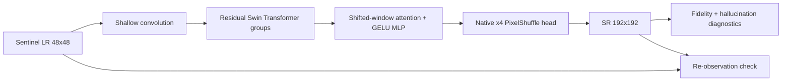

# Swin2SR Native-x4 Diagnostic Pre-registration

Status: locally implemented; private Kaggle source update and GPU execution require explicit approval

Date: 2026-09-11

## Why this experiment is necessary

SUPARCO requires at least 3x enhancement, not exactly 3x. The earlier full-fine-tuning control resized Swin2SR's native x4 output to x3 so it could share the exact target protocol with FaithSR-3X. That result proves useful personalization under the x3 comparison, but it does not establish native-x4 product quality or 512x512 deployment performance.

The immediate question is therefore not which fashionable module to add. It is: **what measurable deficiency remains after native-x4 Swin2SR personalization?** A hybrid is justified only if a targeted component improves that deficiency under a matched ablation.

## Frozen protocol

- Model: `caidas/swin2SR-classical-sr-x4-64`
- Revision: `c69ef3e2d2ac5777ff4a9f2f5afcd86d20604b7e`
- Output: native x4; no x4-to-x3 resize
- Public data: the accepted Sentinel-2 L2A uint8 corpus
- Split: scene/geographic-group separated, seed 0, unchanged from the accepted native-L2A protocol
- Crop: 192x192 HR to 48x48 LR
- Personalization: all model parameters, three epochs, Smooth-L1, AdamW, learning rate `1e-5`
- Methods: bicubic x4, frozen pretrained Swin2SR x4, fully fine-tuned Swin2SR x4
- Stress families: clean bicubic, mild anisotropic, severe blur, noise-heavy, compression-heavy, aliasing-heavy, and low-Nyquist MTF
- Each paired method receives the identical LR observation and HR target.

## Metrics and acceptance rules

Primary reconstruction evidence is per-image PSNR with paired scene-cluster 95% confidence intervals. SSIM and LPIPS measure structure/perception; false-edge rate and edge precision/recall measure unsupported detail; SAM and scale-correct ERGAS measure spectral/radiometric error; re-observation L1 measures agreement with the supplied LR evidence.

The candidate passes a stress family only when the PSNR interval is not materially negative and false-edge/observation behavior does not indicate a hallucination trade-off. LPIPS alone cannot override a fidelity regression. Native-x4 512x512 model-only and end-to-end TIFF timings use 10 warm-ups, 100 measured forwards, CUDA synchronization, mean/median/P95, and peak VRAM. The provisional latency threshold is P95 below one second on the recorded GPU and scope; an out-of-memory result is retained as a failure, not hidden by a smaller input.

## Mathematical mapping, layers, and activations

For a 48x48 LR crop `x`, native Swin2SR predicts a 192x192 target directly:

`y_hat_4 = Swin2SR_x4(x)`.

All parameters minimize:

`L_FT = SmoothL1(y_hat_4, y_4)`.

Swin2SR retains its published shallow convolution, residual Swin Transformer groups, shifted-window self-attention, LayerNorm, GELU MLPs, residual convolutions, and x4 PixelShuffle reconstruction. GELU is retained because changing the pretrained nonlinearity would invalidate weight reuse; PixelShuffle is the model's native learned x4 rearrangement and avoids a post-output scale conversion.

## Decision after results

- degradation-family failure -> test degradation conditioning;
- unsupported edges or LR mismatch -> test bounded observation consistency;
- local high-frequency failure -> test a frequency/detail refiner;
- long-range road/field discontinuity -> test a lightweight Mamba/global-context branch;
- no material quality gap and latency passes -> retain personalized Swin2SR and avoid an unjustified hybrid.

Every best/final model must save its checkpoint, metric table, configuration, environment, degradation records, SHA-256 provenance, and deterministic worst/median/best preview PNG+JSON files.
